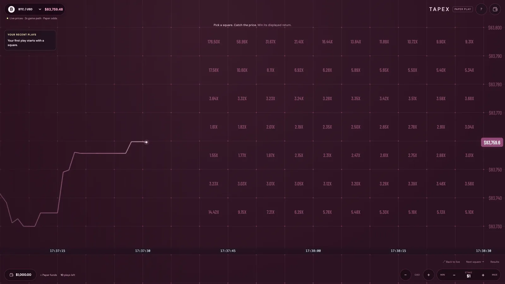
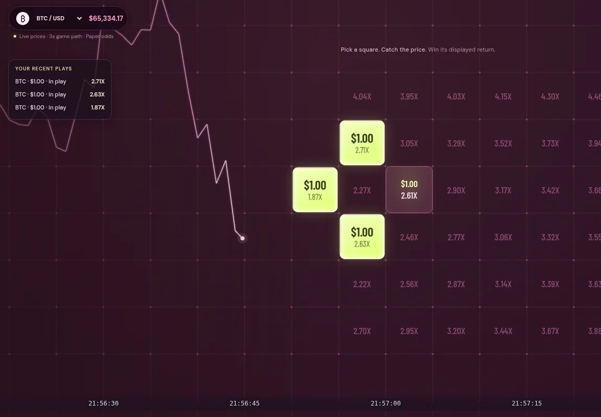
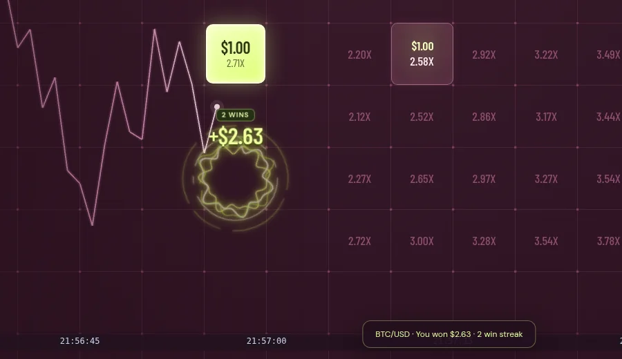
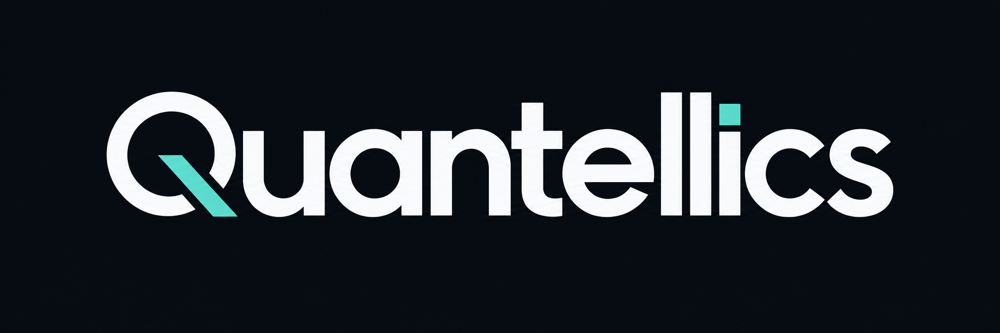
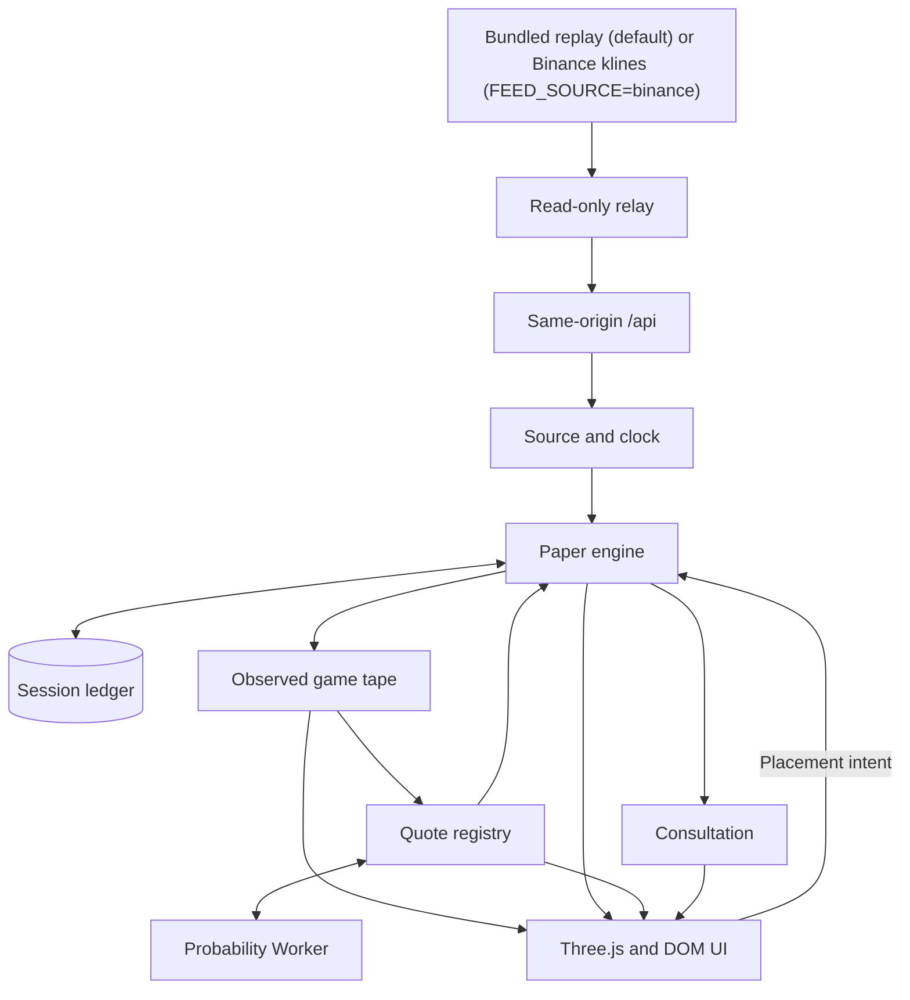
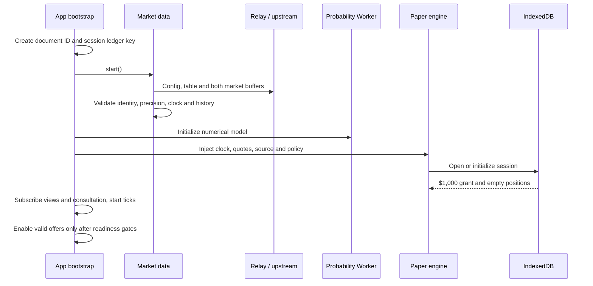
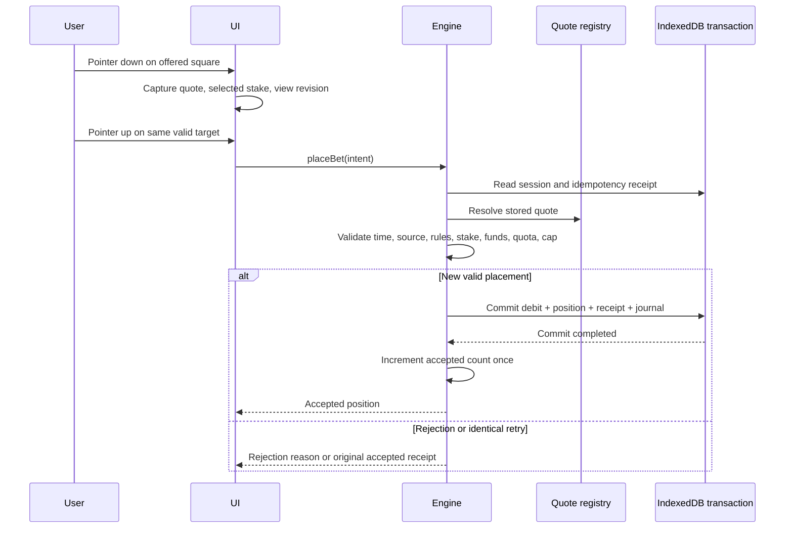
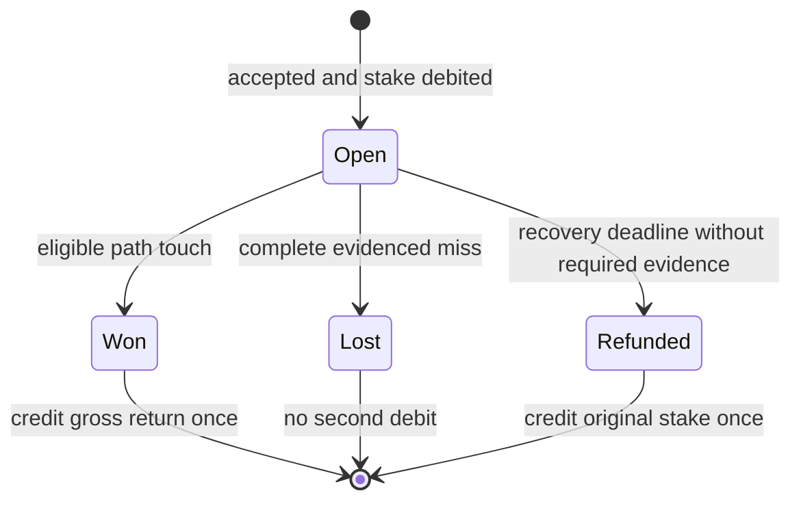
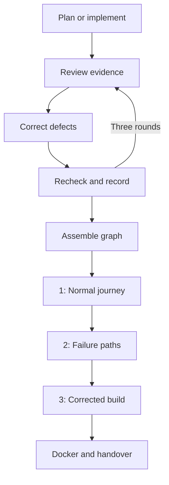

# TapEX — tap-to-trade paper-trading game engine with a live price chart
 

> **Need it installed, customised or supported?** Quantellics installs, customises and supports TapEX on your infrastructure, under your brand. → **[Book a call](https://quantellics.com)** · email: info@quantellics.com

<p align="center"></p>

## What it is (and isn't)
**Maturity: stable.**
- Tap-to-trade grid game: pick a price band, settle against observed prices over a 5-second window.
- Monorepo: demo app, admin, feed relay, house server, recorder, pricing/engine packages.
- Paper quotes only — no deposits, wallets or real-money settlement are wired in.

- **Not investment advice.** Nothing here is financial, legal or tax advice.
- **No KYC, custody or licensing included.** You are responsible for KYC/AML, custody of user funds and any licence your activity requires.
- **Check your jurisdiction.** Operating trading, exchange or tokenisation services is regulated or prohibited in many jurisdictions.

> **Jurisdiction notice:** tap/grid price-prediction products can be classed as gambling, binary options or derivatives. Real-money operation is restricted or prohibited in many jurisdictions (e.g. binary options are banned for retail in the EU/UK). This repository ships paper-trading only. Get legal advice before enabling real money anywhere.
>
> **Price feed:** by default the demo runs fully offline. It replays a bundled, self-generated synthetic recording (CC0, see `apps/feed-relay/data/PROVENANCE.md`). These are **not real market prices**. Set `FEED_SOURCE=binance` to use Binance public market data instead (BTCUSDT/ETHUSDT 1 s klines, no API key). Binance's API terms apply, so check them before any commercial use. No Lynx/Gridy endpoint is called by default.

## 2-minute quickstart
```bash
# Node 24 + pnpm 11.25.0 required (corepack enable)
git clone <repository-url> TapEX && cd TapEX
pnpm install --frozen-lockfile
pnpm build
pnpm --filter @maya/feed-relay dev   # terminal 1, :8787 (offline replay; FEED_SOURCE=binance for live)
pnpm --filter @maya/demo dev        # terminal 2, open http://127.0.0.1:5173
```
Verify: `pnpm test:unit`  ·  Docker alternative: `docker compose up -d --build --wait`

## Screenshots

<table><tr><td width="50%"><br /><sub>Bets placed, payouts shown</sub></td><td width="50%"><br /><sub>Settled result</sub></td></tr></table>

## Customisation map
| What you want to change | Where it lives |
|---|---|
| Branding, UI, colours | `packages/game-ui/`, `apps/demo/` |
| Game settings, house edge, multipliers | `packages/config/src/` (`demo.ts`, `adaptive.ts`) |
| Pricing model | `packages/pricing/`, `packages/engine/` |
| Price feed source (replay / live) | `FEED_SOURCE` env; `apps/feed-relay/src/{replay,binance}.mjs` |
| Replay recording, pricing config, domain table | `apps/feed-relay/data/` (regenerate: `pnpm --filter @maya/feed-relay generate-data`) |
| Markets / client parsing | `packages/market-data/`, `apps/feed-relay/src/markets.mjs` |
| Operator/admin tools | `apps/admin/`, `apps/house-server/` |
| Contracts (testnet) | `contracts/` |

## Services: DIY vs Quantellics
| | Self-host (free) | **Install** | **Customise (Launch)** | **Dedicated support** |
|---|---|---|---|---|
| Source code (AGPL-3.0) | ✓ | ✓ | ✓ | ✓ |
| Installed on your infra / domain | you | ✓ | ✓ | ✓ |
| Branding, features, markets | you | – | ✓ | ✓ |
| Security review, KYC/payments integration | – | – | ✓ | ✓ |
| SLA, on-call, upgrades | – | – | – | ✓ |
| Commercial licence (no AGPL obligations) | – | available | available | included |
| Price | free | Contact us for pricing — info@quantellics.com | Contact us for pricing — info@quantellics.com | Contact us for pricing — info@quantellics.com |

See [SUPPORT.md](SUPPORT.md) or [open an enquiry](../../issues/new?template=enquiry.yml).

## Licence
**AGPL-3.0** ([LICENSE](LICENSE)). If you run a modified version as a network service, you must publish your changes under AGPL-3.0.
Need proprietary/closed-source use? A **commercial licence** is available — see [COMMERCIAL-LICENSE.md](COMMERCIAL-LICENSE.md).
"Quantellics" and product names are trademarks and are not licensed under AGPL.

> **Need it installed, customised or supported?** Quantellics installs, customises and supports TapEX on your infrastructure, under your brand. → **[Book a call](https://quantellics.com)** · email: info@quantellics.com

---

## Technical reference (previous README)

<p align="center">
  <picture>
    <source media="(prefers-color-scheme: dark)" srcset="docs/brand/quantellics-dark.png" />
    <source media="(prefers-color-scheme: light)" srcset="docs/brand/quantellics-light.png" />
    
  </picture>
</p>

<h1 align="center">TapEX · A playable trading experience</h1>
<p align="center">A Quantellics prototype for a customisable, white-label price-time trading game.</p>
<p align="center"><strong>Paper funds · Live public prices · Local simulated odds · Adaptive Three.js interface</strong></p>

TapEX turns a live price chart into a playable board. A visitor chooses BTC/USD or ETH/USD, selects a stake, adjusts zoom, and taps a future price/time square. If the recorded game-price path touches that square during its window, the visitor wins the return locked at acceptance. After ten accepted bets, TapEX presents a white-label consultation offer. Refreshing starts another independent session with **$1,000 and ten plays**.

This repository contains the complete application monorepo, Docker deployment, tests, QA evidence, product research, development graph, node reviews and debugging history. The product is **TapEX** (the in-game name shown to players is "Maya"); **Quantellics** is the company identity. Package scopes (`@maya/*`), rule/model IDs, `MAYA_*` variables and `X-Maya-*` headers are code identifiers and keep their names.

**Current delivery:** a paper sales demo at [tapex.quantellics.com](https://tapex.quantellics.com), also runnable in Docker Desktop. Prices come from an offline replay by default, or from Binance public data when FEED_SOURCE=binance is set. Odds are calculated locally and are not executable market-maker quotes. Wallet and consultation actions open `https://quantellics.com`. Real-money execution, custody, deposits, chain transactions and provider onboarding are future integration work.

## Contents

1. [Run and develop](#run-and-develop)
2. [Game rules and settings](#game-rules-and-settings)
3. [Architecture and technology](#architecture-and-technology)
4. [Process flows and accounting](#process-flows-and-accounting)
5. [Customisation and provider integration](#customisation-and-provider-integration)
6. [QA, operations and handover](#qa-operations-and-handover)

The [documentation library](docs/README.md) indexes the exported Obsidian vault. Its [planning, debugging and results index](docs/obsidian/Maya%20-%20Planning%20Debug%20and%20Results%20Index.md) connects the graph, node loops, fixes and evidence.

## Run and develop

### Docker Desktop

With Docker Desktop running and access to the private repository:

```powershell
git clone <TapEX repository URL> TapEX
cd TapEX
docker compose up -d --build --wait
```

Open **http://127.0.0.1:8080**. Initial builds download pinned base images and dependencies. The default replay feed runs offline; `FEED_SOURCE=binance` needs outbound access to data-api.binance.vision. No API key, provider registration or wallet is required for this demo.

```powershell
docker compose ps
docker compose logs --tail 100
docker compose down
```

The default port is bound to this computer's loopback address. It is not a public or LAN-phone deployment. For another local port in PowerShell:

```powershell
$env:MAYA_PORT = '8081'
docker compose up -d --build --wait
```

`MAYA_PORT` changes only the host port. The web container uses 8080; the internal relay uses 8787. Browser storage belongs to an origin, so a different port has a separate accessible IndexedDB store.

### Local development

Use **Node 24** and **pnpm 11.25.0**. [.node-version](.node-version) records the checked Node version, 24.21.0. Versions and dependencies are pinned by [package.json](package.json) and [pnpm-lock.yaml](pnpm-lock.yaml).

```powershell
pnpm install --frozen-lockfile
pnpm build
```

In separate terminals:

```powershell
pnpm --filter @maya/feed-relay dev
```

```powershell
pnpm --filter @maya/demo dev
```

Open http://127.0.0.1:5173. Vite proxies `/api` to the relay at 8787. Shared packages export compiled ESM and declarations from `dist/`. Rebuild a modified package before refreshing, or run its watch task. `pnpm dev` runs available workspace watch tasks through Turbo.

```powershell
pnpm --filter @maya/game-ui build
pnpm --filter @maya/engine test:unit
pnpm check
```

The UI copies styles through an explicit [asset list](packages/game-ui/scripts/copy-assets.mjs). Add new CSS files to that list; adding an import alone can leave production output incomplete.

### Repository contents versus generated files

Git includes application source, dependency lockfile, deployment configuration, docs and relevant evidence. Installed dependencies, generated builds, caches, temporary clean-build workspaces and local credentials/environment files are ignored. Run installation/build after cloning. Archived research scripts are evidence, not required startup tasks.

## Game rules and settings

### How a play works

1. Choose a market and allowed stake.
2. Tap an offered future square. Its width represents time; its height represents a price band.
3. TapEX records the exact stake, quote, odds, square and rule version, then deducts the stake.
4. A qualifying touch wins, a fully evidenced miss loses, and unresolved missing evidence eventually refunds.
5. The tenth accepted placement opens the consultation offer. Existing bets can finish while the document remains open; refresh creates a new session.

Prices determine results. Odds determine returns. No random draw decides whether a placed bet wins.

### Current settings

| Setting | Current value | Source |
|---|---|---|
| Product and mode | TapEX, paper-demo, USD display | [demo.ts](packages/config/src/demo.ts) |
| Markets | BTC/USD and ETH/USD | `MARKETS` |
| Starting funds / refill | $1,000 each | `startingBalanceCents`, `refillCents` |
| Stake choices | $0.10, $0.50, $1, $5, $10; default $1 | `stakeMenuCents`, `initialStakeCents` |
| Maximum placement | $10 | `maxStakePerBetCents` |
| Aggregate accepted stake per canonical square | $50 | `maxAcceptedStakePerCellCents` |
| Quota | 10 newly accepted placements per document | `maxNewBetsPerPage` |
| Time window | 5 seconds, aligned to five-second epochs | Config, contracts, pricing and engine |
| Band height | BTC $10; ETH $0.50 | `MARKETS[].bandHeight` |
| Zoom | Minimum 0.345, initial 0.6, maximum 0.9 | `zoom` |
| Zoom buttons | ×1.1 in, ×0.9 out, clamped | `stepZoom` |
| Recent plays | Five newest entries maximum | [game UI](packages/game-ui/src/index.ts) |
| Contact URLs | `https://quantellics.com` (override: `VITE_MAYA_CONSULTATION_URL`) | `consultationUrl` |
| New settlement rule | `maya-observed-linear-v2` | [path-touch.ts](packages/contracts/src/path-touch.ts) |
| New odds model | `maya-gaussian-linear-six-v2` | [quote registry](packages/pricing/src/index.ts) |

Zoom buttons use multiplicative steps; pinch/wheel gestures can produce intermediate values within bounds. Zoom changes presentation, not an accepted square's underlying price/time terms.

### Repeated bets on one square

Each accepted click adds the selected stake as an independent leg. With $5 selected, one/two/three/four accepted clicks show **$5/$10/$15/$20** on the grouped card. Each leg preserves its own locked odds. Rejected clicks consume neither funds nor quota. Retrying an already committed request with identical intent returns its receipt without a second debit.

Cards show summed stake, leg count and exact summed return. They do not invent averaged odds. Example: $1 at 2.51× + $1 at 2.51× + $5 at 3.20× gives **$7 stake and $21.02 total winning return**. Changing the selector changes only future clicks.

### Returns and model economics

Multipliers include the original stake. A $5 bet at 2.50× returns $12.50 total, or $7.50 net profit. A loss returns zero; a refund returns the original $5.

Money is represented as integer-cent strings. `grossX100` is integer hundredths of a multiplier: `"250"` means 2.50×. [units.ts](packages/contracts/src/units.ts) computes exact rounded cents with BigInt:

```text
grossReturnCents = floor((stakeCents × grossX100 + 50) / 100)
```

The local model converts probability `p` and edge `e` into:

```text
grossX100 = floor(100 × (1 - e) / p)
displayed multiplier = grossX100 / 100
```

The public pricing configuration supplies `houseEdge`, `minPayoutX` and minimum lead time. Invalid volatility, unsupported domain/geometry, zero probability, below-minimum return and unsafe numerical ranges make a cell unavailable. There is no separate universal maximum-odds setting. Numerical verification does not establish empirical calibration or a market-maker commitment.

### Exactly what a touch means

New bets use the first observation persisted for each source second in that session. Adjacent one-second observations form straight segments. The chart and engine share this immutable game tape; a later upstream revision cannot rewrite an already pinned point.

Price edges are inclusive. Time is **half-open: [start, end)**. A connector entering the band before the deadline wins even if neither endpoint lies inside. Touching only at the end timestamp does not win. A complete five-second miss needs six observations, including the deadline endpoint that describes the last segment. Missing intervals are not bridged.

Collision decisions use rational arithmetic in [path-touch.ts](packages/contracts/src/path-touch.ts); the approximate touch timestamp is for rendering. Historical `maya-sampled-v1` positions retain their original accepted rules. The v2 record is a defined paper-game path, not a claim that early upstream observations are final exchange settlement prices.

## Architecture and technology

### Technology stack

| Layer | Implementation | Purpose |
|---|---|---|
| Workspace | pnpm 11.25.0, Turborepo 2.11.2 | Dependency graph, task ordering and local cache |
| Language | TypeScript 7.0.2, ESM; JavaScript relay | Shared contracts and module boundaries |
| Browser build | Vite 8.3.0 | App/worker bundling and development proxy |
| Chart | Three.js 0.186.0 | Animated WebGL price geometry |
| Controls | Native DOM, HTML buttons/dialogs and CSS | Accessible input, offer targets and overlays |
| Model execution | Dedicated Web Worker, Gaussian quadrature | Numerical work outside the animation thread |
| Precision | BigInt, exact decimal values, rational intersections | Money and boundary decisions |
| Persistence | Browser IndexedDB | Atomic paper ledger, receipts and evidence |
| Relay | Node 24 `node:http` and native `fetch` | Fixed public reads and timing metadata |
| Serving | Unprivileged nginx, Docker Compose | Static app, same-origin proxy and health |
| Tests | Vitest 5.0.1, fake-indexeddb 6.2.5, Node test runner | Unit/storage/relay verification |
| Boundary analysis | @babel/parser 7.29.9 | Import and dependency checks |
| Browser evidence | Automation/CDP captures and audit scripts | Geometry, native input, accounting and timing |
| Game fonts | DM Sans and Barlow Condensed via Google Fonts CSS | Typography with sans-serif fallback |

There is no React framework, server database or blockchain SDK in the current application. The Quantellics logo is a repository asset and does not rename the game.

### Monorepo map

```text
TapEX/
├── apps/
│   ├── demo/                   # Composition, probability worker, sales controller
│   ├── feed-relay/             # Fixed public GET relay and tests
│   └── recorder/               # Server-side price and odds log, five-hour segments
├── packages/
│   ├── contracts/             # Types, exact units, identities, collision rules
│   ├── config/                # Settings, adaptive policy and provenance
│   ├── market-data/           # Price-feed parsing (relay wire format), clock, health, recovery
│   ├── pricing/               # Local model and immutable quote registry
│   ├── engine/                # Acceptance, accounting, settlement, quota
│   └── game-ui/               # Three.js/DOM UI, gestures and effects
├── docker/nginx.conf          # Static serving and /api proxy
├── compose.yaml               # Local services
├── Dockerfile                 # Pinned multi-stage build
├── tooling/                   # Boundaries, audits, documentation exporter
├── artifacts/verification/    # Raw build/browser/model/QA evidence
├── docs/
│   ├── README.md              # Documentation directory
│   ├── brand/                 # Quantellics logos and provenance
│   └── obsidian/              # Notes, graph and research attachments
└── pnpm-lock.yaml
```

### Runtime component graph



This is the runtime data graph. The import graph is intentionally narrower: feature packages depend on shared contracts/config; [bootstrap.ts](apps/demo/src/bootstrap.ts) composes the concrete data, pricing, engine and UI objects. Feature packages do not import sibling implementations. [check-boundaries.mjs](tooling/check-boundaries.mjs) enforces that separation.

| Module | Owns | Does not own |
|---|---|---|
| Contracts | DTOs, IDs, exact units and collision functions | Connections or visual presentation |
| Config | Scope, settings, copy, adaptive defaults | Accepted records or settlement |
| Market data | Parsing, source identity, buffers, health, time | Balances or outcomes |
| Pricing | Probabilities, valid domains, immutable quote IDs | Money or provider execution |
| Engine | Acceptance, debit, evidence, terminal credit, allowance | Chart styling and decoration |
| Game UI | Rendering, picking, gestures, cards and effects | Authority to invent results or modify accepted odds |
| Demo app | Composition and lifecycle | Provider credentials or server-authoritative finance |
| Relay | Allowlisted reads, caching, timing metadata | Orders, wallets or arbitrary URL proxying |

### Core contracts

[contracts.ts](packages/contracts/src/contracts.ts) defines:

| Type | Meaning |
|---|---|
| `DecimalValue` | Exact `coefficient × 10^exponent`; coefficient is a string |
| `PriceSample` | Market/feed/pair identity, source/receive timestamps, exact price and optional response hash |
| `CellTerms` | Canonical ID, market, time interval, price bounds and rule version |
| `QuoteSnapshot` | Cell terms, quote ID/revision, gross multiplier, source/generation/expiry timestamps and provenance; currently `simulated: true` |
| `PlacementIntent` | Request ID, document ID, quote ID/revision, cell ID and requested stake |
| `PositionSnapshot` | Immutable accepted terms, exact return, state and settlement evidence |
| `ClockSnapshot` | Estimated source-aligned time, uncertainty and readiness |
| `CoverageReport` | Completeness, sample IDs, watermark, policy and conflicts |
| `PaperSnapshot` | Revision, balance, positions, readiness and error |

The click request does not provide a trusted payout. The engine resolves the registered quote itself. Strings preserve money and source decimals across boundaries; display floats do not replace exact accounting.

The current types are deliberately narrow: market ID, symbol, pair ID and chain use literal unions for this two-market demo. Adding a provider/pair/chain can require contract changes rather than a configuration-only edit.

## Process flows and accounting

### Startup and readiness



Both markets remain active so switching the selected view does not abandon open bets. Readiness depends on source/clock health, sufficient history, ledger state, quote book and Worker. Errors leave betting unavailable and reconnect attempts active. No fabricated price or alternate provider silently replaces a failed source.

### Price transport, clock and evidence

[server.mjs](apps/feed-relay/src/server.mjs) serves fixed routes. The price source comes from `FEED_SOURCE`: `replay` is the default, `binance` is optional.

| Local route | `replay` (default, offline) | `binance` | Cache TTL |
|---|---|---|---|
| `/api/config` | Bundled `data/maya-config.json` | same | static |
| `/api/prices/1` | Bundled BTC recording, re-timed to wall clock | `data-api.binance.vision` BTCUSDT 1 s klines | 600 ms |
| `/api/prices/2` | Bundled ETH recording, re-timed to wall clock | ETHUSDT 1 s klines | 600 ms |
| `/api/table` | Bundled `data/maya-domain-table.json` | same | static |
| `/health` | Local health response | Local response |

Concurrent identical requests are coalesced. Unknown routes/non-GET methods are rejected. Redirects are not followed. Responses over 2 MB are rejected. Upstream failures return 503 with bounded retry metadata instead of a successful stale feed.

The relay preserves `X-Maya-Upstream-Date`, `X-Maya-Upstream-Rtt-Ms` and `X-Maya-Upstream-Age-Ms`. [SourceClock](packages/market-data/src/clock.ts) combines those with client request timing and a monotonic clock. It never treats the newest price timestamp as “now.” Old, conflicting or uncertain clock evidence pauses acceptance.

[normalization.ts](packages/market-data/src/normalization.ts) preserves numeric price lexemes before decimal conversion. It validates top-level `chain`, `pair`, `feedId`, `count` and a `prices` array of `{t,p}`; `t` is epoch seconds. Replacing this payload requires a new parser.

[policy.ts](packages/market-data/src/policy.ts) records one-second cadence/polling, three-second stabilization for the legacy source track, seven-second freshness, 30 warmup samples, 120-second ordinary history retention and a 30-second recovery deadline. The v2 engine separately receives validated observed values, pins their first stored value and publishes that tape to UI/pricing. Stabilized samples still matter to health and legacy compatibility.

### Quote creation

The quote book uses up to 68 recent game samples with contiguous cadence. EWMA log-return volatility defaults to λ = 0.94. The v2 model prices a six-observation connected-path event:

```text
P(touch) = 1 - P(all six below the lower bound)
             - P(all six above the upper bound)
```

Deterministic Gaussian quadrature computes the survival probabilities. The published table is retained for domain/provenance validation, not used as the final v2 payout calculator. An earlier event-equivalence assumption failed and remains documented.

[BackgroundPricing](apps/demo/src/background-pricing.ts) batches numerical requests to [pricing-worker.ts](apps/demo/src/pricing-worker.ts). Every model input contributes to the cache key. Main-thread code owns immutable quote issuance and acceptance. Pending calculations may reuse an existing quote only within its original expiry and matching configuration/policy.

Expiry is bounded by source receive time + 1,800 ms TTL, square start minus minimum lead time, and the seven-second freshness ceiling. Acceptance checks current time and uncertainty again. Candidate coverage and visible viewport coverage are separate metrics.

### Placement transaction



The engine serializes operations and uses one aggregate ledger record as the IndexedDB transaction boundary. The UI captures selected stake at pointer down. Pointer up must still match the square and view revision. Dragging, resize, modal changes and invalid gesture state cancel the action. No monetary update is final before commit.

### Settlement and presentation



`tick()` merges eligible evidence and processes open positions. Terminal journal entries prevent repeated credits. Loss does not debit again. A grouped square can contain multiple immutable positions; display totals sum their exact locked returns.

Win presentation waits until the visible playhead reaches the recorded touch. Effects never decide outcomes. One winning square increments the streak once even with several legs: ring for win 1, double ring for win 2, starburst for wins 3–4, gold/lime nova for wins 5+. Loss resets the streak; refund is not a win. Effects deduplicate and clean up.

[timeline.ts](packages/game-ui/src/timeline.ts) smooths motion within observed history and never extrapolates beyond the newest observation. The current v2 path is linear. Reduced motion removes decorative animation.

### Refresh, storage and consultation

At module startup, `pageLoadId = crypto.randomUUID()` and `ledgerKey = session:<pageLoadId>`. Normal reload creates a new session with $1,000, no positions/recent history and ten plays. Previous records remain for audit but cannot affect the fresh balance. Other tabs are independent. Reconnecting one document does not create another grant. A back/forward-cache restoration is not a fresh document reload.

IndexedDB uses database `maya-paper-v1`, object store `paper`, schema version 1. [storage.ts](packages/engine/src/storage.ts) contains balances, positions, receipts, refill IDs, exposures, source/observed samples, conflicts and journal entries. Idle evidence pruning preserves relevant position evidence. There is not yet a global cleanup policy for all archived sessions; a sustained public deployment should define retention.

The [ConsultationController](apps/demo/src/sales-flow/ConsultationController.ts) opens after the tenth newly accepted placement and acknowledges actual visible presentation. Rejections and retries do not count. Dismissal permits watching results but does not restore quota. Refill adds paper funds without restoring quota. Refresh resets the demo.

The wallet icon to the right of `?` opens a native chain/wallet customisation contact dialog. It has no wallet SDK, connection/signature flow or transaction. Its **Contact us** button opens [quantellics.com](https://quantellics.com) in a new tab, so visitors can get Quantellics' installation and customisation help. The destination defaults to `https://quantellics.com` (`DEFAULT_CONSULTATION_URL` in [packages/config/src/demo.ts](packages/config/src/demo.ts)) and can be overridden at build time with `VITE_MAYA_CONSULTATION_URL` (HTTPS only). Escape, close and backdrop dismissal return focus; background bets are blocked while open.

## Customisation and provider integration

### Source change map

This is source-level customisation, not a tenant administration console. Frozen defaults, literal unions and validators enforce the current scope. Update relevant validation and provenance with an intentional rule change.

| Change | Primary files | Related checks |
|---|---|---|
| Identity, funds, stakes, caps, quota, CTA | [demo.ts](packages/config/src/demo.ts), [validate.ts](packages/config/src/validate.ts) | Config/engine/controller tests; literal help/error text |
| Colours, fonts and controls | [styles.css](packages/game-ui/src/styles.css), [controls.css](packages/game-ui/src/controls.css), [motion.css](packages/game-ui/src/motion.css) | Text fitting, focus, disabled/reduced-motion states, asset copying |
| Adaptive composition | [adaptive.ts](packages/config/src/adaptive.ts), [adaptive.css](packages/game-ui/src/adaptive.css), [layout.ts](packages/game-ui/src/layout.ts) | Pointer capability, safe areas, picking and short landscape |
| Price line and animation | [index.ts](packages/game-ui/src/index.ts), [timeline.ts](packages/game-ui/src/timeline.ts), [feedback.ts](packages/game-ui/src/feedback.ts) | Displayed event must agree with settlement |
| Grouped legs/streaks | [position-groups.ts](packages/game-ui/src/position-groups.ts), `feedback.ts` | Exact immutable sums and one streak increment per square |
| Price API | [relay](apps/feed-relay/src/server.mjs), [market-data](packages/market-data/src/index.ts), [parser](packages/market-data/src/normalization.ts), [bootstrap](apps/demo/src/bootstrap.ts) | Identity, time, precision, cadence, gaps and recovery |
| Local odds | [model.ts](packages/pricing/src/model.ts), [linear-probability.ts](packages/pricing/src/linear-probability.ts), [registry](packages/pricing/src/index.ts) | Worker, rounding, domain, provenance and independent reference |
| External odds | Quote adapter, bootstrap and contracts | Async prefetch, immutable terms, expiry, capacity and quote type |
| Bet/execution API | Engine port, bootstrap and new backend | Server ledger, acceptance, idempotency, settlement and reconciliation |
| Pairs/chains | [contracts.ts](packages/contracts/src/contracts.ts), `MARKETS`, parser and relay | Broaden literal types; validate identities, geometry and model support |
| Duration/cadence | Contracts, policy, pricing, engine and geometry | New versioned event and complete replay verification |
| Quantellics company identity | [brand assets](docs/brand/README.md), this README | Separate from the in-game brand |

### Replace the price API

**The price source lives in the relay.** The browser only talks to same-origin `/api`. Bootstrap constructs the market-data client (`LynxMarketData({baseUrl:'/api'})`; the class name reflects the relay's JSON wire format, not an upstream). The relay serves `/api/config` and `/api/table` from bundled files and prices from the selected source: `replay` (default, offline) or `binance` (`FEED_SOURCE=binance`). Add a source in `apps/feed-relay/src/` that emits the same wire format.

A same-protocol host change may only require route updates and revalidation. A different provider needs these steps:

1. **Specify source meaning.** Define exact market, quote currency, price type and timestamps. BTC/USDT last trade, BTC/USD oracle index and spot midpoint are different inputs. Update labels and authority identities accordingly.
2. **Implement an adapter.** Satisfy `MarketDataPort` and `ClockPort`; normalize prices losslessly and retain source versus receive time, health, completeness and conflicts. Or keep the client and adapt the new payload to the relay wire format server-side, as `apps/feed-relay/src/binance.mjs` does.
3. **Cover composition methods.** Bootstrap also uses `start`, `stop`, `revalidate`, `retainWindows`, `getDisplaySamples`, `getConfig`, `getTable`, `getTableId` and `getMinLeadMs`. Implement equivalents or split source/model-config/clock services in bootstrap. The narrow port alone is not a complete drop-in for this concrete composition.
4. **Replace transport and clock deliberately.** Add fixed backend routes or server streaming fan-out. Preserve timing metadata or replace SourceClock with a documented synchronization method. Keep authenticated credentials server-side.
5. **Reverify event behavior.** Exercise precision, cadence, gaps, revisions, symbol mismatch, clock uncertainty, stale source, reconnect and historical recovery, then both markets' complete browser journeys.

Current interface outline:

```ts
interface MarketDataPort {
  getHealth(marketId: MarketId): InputHealth;
  getSamples(marketId: MarketId, fromMs?: number, toMs?: number): readonly PriceSample[];
  getCoverage(marketId: MarketId, startMs: number, endMs: number): CoverageReport;
  getConflictingSampleIds?(marketId: MarketId): readonly string[];
  subscribe(listener: (marketId: MarketId) => void): Unsubscribe;
}
interface ClockPort {
  getClock(): ClockSnapshot;
}
```

The v2 event requires adjacent one-second observations. A higher-frequency feed needs a specified sampling/bucketing policy. A slower source cannot be made equivalent by inventing points. A changed cadence or price definition needs a new rule/policy identity, matching model and matching visible path. Old accepted terms must remain interpretable.

For a Binance USDT spot integration, update symbol labels, identity, parsing and sampling rather than retaining USD labels. For Wintermute or another authenticated maker, use the actual provider's supported instruments, agreement and integration docs. There is no Wintermute adapter or access credential in this repository.

### Replace or customise odds

**Path A: retain local simulated odds.** Change the pure model in `packages/pricing`, preserve exact gross-return conversion and keep expensive work in the Worker. Update `modelId`, configuration/policy identity and table/domain provenance. Every model-affecting input must enter the cache key. Recheck volatility, bounds, minimum payout, expiry and numerical accuracy with an independent reference.

Changing edge changes return, not the touch outcome. Replacing touch with terminal direction, a different barrier horizon or another sampling rule requires a corresponding model and versioned event.

**Path B: consume a provider quote API.** Replace concrete `PaperQuoteBook` wiring with an adapter/cache. `quoteFor` in the UI is synchronous: prefetch or subscribe asynchronously and expose only validated stored snapshots. Maintain `QuoteRegistryPort.getQuote(quoteId)` so acceptance resolves authoritative stored terms rather than client-supplied odds.

| Provider term | Mapping/work required |
|---|---|
| Instrument/event | Exact market, band edges, time interval and rule identity |
| Quote ID/revision | Immutable ID/revision; accepted snapshots cannot be overwritten |
| Odds/premium/probability | Convert explicitly to gross-return semantics; an option premium or probability is not itself a multiplier |
| Issue/expiry time | Source/generation/valid-until timestamps checked with trustworthy time and uncertainty |
| Stake-dependent quote | Add size to request/cache identity; current preview is cell-based, not a maker RFQ by amount |
| Min/max size and capacity | Extend and enforce terms at acceptance |
| Fees/currency | Define exact net versus gross and currency units |
| Signature/execution token | Add validation and backend enforcement for live quotes |
| Provenance | Provider, event/rule, config and source identities for audit |

`QuoteSnapshot.simulated` is currently the literal `true`. Do not disguise executable quotes as simulated to satisfy the type. Add an explicit discriminated contract and update consumers for executable quotes. Displaying a maker quote is not execution.

The current bootstrap loads the pricing config and domain table from the relay (bundled, self-generated files in `apps/feed-relay/data/`) and initializes the Worker. An external-odds integration must remove or replace those dependencies; changing only `quoteFor` can leave startup blocked on an irrelevant table. There are currently no implemented `PRICE_API_URL`, `ODDS_API_URL` or `BET_API_URL` runtime switches. Turbo's allowed environment patterns do not create such integrations.

### Replace paper bets with an execution API

The existing entry is `onBet` in [bootstrap.ts](apps/demo/src/bootstrap.ts), calling `PaperEngine.placeBet`. `PaperEnginePort` offers snapshot, allowance, placement, refill, acknowledgement and subscription. The app additionally uses concrete initialization, ticking, game-tape/audit reads and disposal; replacing the engine also requires replacing/refactoring these dependencies.

For a **server-hosted paper demo**, use an HTTP/WebSocket adapter and move quote acceptance, accounting and settlement to a server. Session creation can grant the chosen demo funds/quota. Preserve refresh-reset semantics explicitly: refresh must create a new demo session, not repeatedly credit an existing account.

For **real trading**, browser IndexedDB is a cache, not financial authority. An authenticated backend must validate maker terms, execute/confirm acceptance, maintain a durable ledger and reconcile positions with provider/chain settlement. API credentials and signing keys belong behind that backend boundary.

The following are **proposed integration endpoints, not existing routes**:

| Proposed route | Responsibility |
|---|---|
| `POST /v1/demo-sessions` | Create isolated paper session and quota/grant |
| `GET /v1/quotes` or quote stream | Event- and, if needed, size-specific quotes |
| `POST /v1/bets` | Idempotent acceptance using account/session, registered quote and exact stake |
| `GET /v1/bets/by-request/<requestId>` | Reconcile an ambiguous timeout without duplicating a bet |
| `GET /v1/session` and event stream | Authoritative balance, positions, quota and outcomes |

An intent derived from the current contract:

```json
{
  "requestId": "stable-client-request-uuid",
  "pageLoadId": "paper-session-id",
  "quoteId": "provider-or-server-quote-id",
  "revision": 12,
  "cellId": "canonical-event-identity",
  "stakeCents": "500"
}
```

The server resolves the quote and calculates return itself. Keep the same request ID when reconciling uncertain responses. A timeout is not a rejection and must not cause a new-ID automatic retry.

Current `PlacementResult` only has accepted/rejected states. If provider execution is asynchronous, add pending/reconciling states to contracts and UI. Define fund/capacity reservation, final acceptance and rejection atomically. Do not announce final acceptance or consume final quota before it is known.

When the backend owns settlement, browser `tick()` must stop being financial authority. Consume server outcomes/evidence and keep the visible source/event consistent. Maker expiry, fees, rounding, refunds, chain finality and oracle choice are instrument terms. Spot bid/ask prices alone do not supply quotes or execution for these touch bets.

### Change stakes, geometry, copy and brand

**Stakes/funds:** update cent-string config, validation and tests. The menu must increase, contain the initial stake and fit coherent per-bet/per-square caps. Search help/toast copy for literal `$50`, `$1,000` and `10`. Recheck insufficient funds, mixed odds, repeated clicks, rounding and immutable accepted terms.

**Quota/CTA:** update config, validation, controller copy and engine tests together. The validator currently requires ten plays. Keep new acceptance, rejection, duplicate retry, refill and dismissal distinct.

**Duration/bands:** five seconds is validated in several packages; the model also requires one-second cadence. This is not only a chart option. Update canonical identity, alignment, candidate generation, model domain, exact touch logic and recovery policy as a versioned change.

**Brand/theme:** update product config/validation, wordmark/help/contact strings, app title and assets as appropriate. Direct CSS colours currently predominate over a full theme-token system. A multi-brand offering should introduce a validated theme configuration. New styles need asset copying and a rebuilt image. Quantellics' repository wordmark remains separate from the in-game identity.

### Adaptive views

| Profile | Selection | Configured DPR cap |
|---|---|---|
| Mobile | Width <768 px or height <500 px | 1.5 |
| Tablet | Remaining width <1,200 px, or coarse pointer with width <1,440 px | 1.5 |
| Desktop | Remaining viewports | 2 |

Safe areas, visual viewport changes and short landscape are handled separately. The session/engine survives composition changes; resizing must not grant funds or reset quota. Chart and DOM targets share transforms; view changes invalidate captured gestures.

Phones use a **single 58 px thumb bar** with menu, stake minus, selected stake/presets, stake plus and zoom access. Balance moves to the header; MIN/MAX, paper funds, navigation, help and wallet remain available in accessible dialogs. [phone-controls.ts](packages/game-ui/src/phone-controls.ts) shares the existing actions; [phone.css](packages/game-ui/src/phone.css) only activates for narrow views (<768 px), or touch landscape up to 1,000 px wide and under 500 px high. The tested tablet/desktop layouts remain unchanged.

On phones, [boardProjection](packages/game-ui/src/geometry.ts) separates canvas height from the horizon-constrained square scale. At 390 × 844 the canvas increases from approximately 373 px to 682 px without changing canonical square terms or moving the nearest eligible future window closer. Pinch tracking captures both pointers and survives intermediate zoom renders, clamps to 0.345–0.9 and suppresses bets/panning from a remaining finger. Rotation, cancellation and touching a control cancel pending board taps. If a quote becomes unavailable during a phone tap, the UI explains the rejection; it never substitutes odds or automatically resubmits a bet.

Recent plays overlays the upper-left chart instead of consuming a separate chart strip. The requested final sizing uses 0.89 scale, desktop/tablet base width 222.3 px, smaller text and a mobile available-width bound. Only five entries render.

Review desktop, tablet, mobile, narrow mobile and short landscape after visual changes. Include focus/keyboard paths, configured 44 px controls, hover/press/disabled states, text fitting, modal isolation and reduced motion. Existing device evidence is emulated viewport/touch testing.

## QA, operations and handover

### Graph, nodes and review loops

The six nodes were foundation, prices/odds, engine, experience, consultation and integration. Each received three planning reviews. The monorepo/adaptive amendment triggered additional recorded reviews; three sequential assembled-graph passes used frozen inputs and correction records.

Runtime implementation had its own correction/recheck rounds. Planning PASS was not treated as runtime proof. Later work addressed path/settlement alignment, stake labels, multiple clicks, frame pacing, streaks, overlays, wallet contact and fresh sessions.



See the [QA log](docs/obsidian/Maya%20-%20Graph%20QA%20Log.md), [node plans](docs/README.md#node-plans-and-their-review-loops), [runtime integration](docs/obsidian/Maya%20Runtime%20-%20N6%20Integration%20and%20Docker.md) and [debug/result index](docs/obsidian/Maya%20-%20Planning%20Debug%20and%20Results%20Index.md). Not all 111 original planned acceptance cases were certified.

### Recorded verification results

| Check | Result and scope |
|---|---|
| Full workspace | 165 unit tests, boundaries, typechecks and production build pass |
| Mobile thumb bar and pinch | Three successful candidate gauntlets, three consecutive final Docker passes (112 checks each), and three public passes (113/112/112); native multi-touch, six phone sizes, repeated stakes, consultation/refresh, BTC/ETH, safe areas and baseline tablet/desktop geometry |
| Latest wallet/session browser | 53 checks across five emulated profiles |
| Ten-bet session | One consultation, ten settled losses, 141 exact ledger checks; refresh returned $1,000 and ten plays |
| Repeated stake input | 60 amount checks: five stakes × four counts × three profiles; separate live four-click $5 run passed 33 debit checks |
| Earlier v2 outcome ledger | 27 positions: seven wins/twenty losses; 365 exact checks at that revision |
| Worker frame pacing | Two 20-second runs, 1,201 frames each, p95 16.8 ms, no frames >50 ms on the measured host |

The current 165-test breakdown is 26 contracts, 15 config, 17 market-data, 25 pricing, 43 engine, 32 game UI, four relay and three recorder tests. [Mobile gauntlet evidence](artifacts/verification/mobile-thumbbar/) preserves failures and successful reruns. The test harness retries only a confirmed quote-change rejection with unchanged acceptance/position counts; it fails on an unexplained or ambiguous input result. Each report retains its own build identity, inputs and limits. Historical browser results are not automatically fresh verification of every subsequent edit.

The original wallet/session closeout used `index-C17uMyXW.js`, `index-CKtWwCWC.css`, `pricing-worker-B5eTPeMV.js`. Current mobile release receipts are in the mobile gauntlet evidence. Vite hashes change when application source changes.

### Verification commands

```powershell
pnpm check
pnpm --filter @maya/engine test:unit
pnpm --filter @maya/pricing test:unit
pnpm --filter @maya/market-data test:unit
pnpm --filter @maya/game-ui test:unit
```

For uncached checks on the pinned Turbo version:

```powershell
pnpm exec turbo run build typecheck test:unit --cache=local:
```

Do not combine `--force` with `--cache` on this version. Live probes, browser journeys and evidence tasks are uncached. Root task names are orchestration hooks, not a promise that every workspace has a full e2e runner. Evidence harnesses may require a browser/CDP endpoint; inspect arguments before execution.

Provider/settlement changes need independent event/model comparison, stale-source cases, exact ledger reconciliation and visible complete journeys. Unit results alone do not establish third-party availability or visual outcome alignment.

### Inspection and troubleshooting

`window.__mayaReadOnly.snapshot()` and `.view()` expose read-only diagnostics. `?inspect` displays the current session audit. [browser-ledger.js](tooling/browser-ledger.js) resolves the current ledger key from diagnostics. Production has no fixture mutation API for fake wins or balances.

| Symptom | Inspect | Next action |
|---|---|---|
| Page unavailable | Compose status/logs, web health | Start services; resolve port or build failure |
| Page but no offers | Source/clock/Worker/ledger readiness; API responses | Diagnose relay error, stale/gapped history, config mismatch or storage |
| Persistent paused source | Identity, config/table hash, source age | Repair mismatch; refresh to validate changed config; do not force stale quotes |
| Rejected click | Reason, captured quote, time/view revision | Check expiry/lead, cap, funds, quota or cancelled gesture |
| Win presentation seems delayed | Recorded touch and playhead | Animation waits for chart arrival; reconcile ledger before rewriting results |
| UI edits absent | Package dist and served hashes | Rebuild owning package/image and refresh |
| New CSS breaks build | Asset-copy list | Add stylesheet to copy list and verify production |
| Storage unavailable | IndexedDB access/quota and engine error | Restore storage; existing records are preserved |

The earlier missed-win investigation found a mismatch between sampled settlement and drawn connectors, corrected by v2. The user's six historical win credits reconciled. The exact disputed visual moment could not be reconstructed. The [integrity report](docs/obsidian/Maya%20Runtime%20-%20Bet%20Integrity%20and%20Leaderboard.md) preserves that distinction.

### Docker and production handover

[Dockerfile](Dockerfile) pins Node24-alpine and nginx-unprivileged images by digest. The build installs the lockfile and builds the demo dependency closure. The relay uses the Node user. Compose drops capabilities, prevents privilege escalation, uses read-only roots and bounds nginx temporary storage.

[nginx.conf](docker/nginx.conf) serves assets, proxies the relay, caches hashed assets immutably and prevents stale app-shell caching. A relay health response proves local process health, not upstream market availability. [.dockerignore](.dockerignore) excludes documentation, evidence, tests/dev entries and local environment files. Research videos and company logos are repository documents, not game downloads.

### Market log recorder

[apps/recorder](apps/recorder/src/main.mjs) is a third Compose service. It polls the relay once per second, so it shares the relay's upstream cache with the game, and runs the production `LynxMarketData` and `PaperQuoteBook` without a browser. Per market it appends one price row per second (`first` value the game pins, `final` value after stabilization) and one odds row for every new price point (spot, sigma and the 42 canonical cells as multiplier ×100 or a negative unavailability code). Files are CSV, cut into epoch-aligned five-hour segments; a closed segment is gzipped once and never changes. The column reference is written to `README.md` inside the log directory ([source](apps/recorder/src/readme.mjs)).

`MAYA_MARKET_LOG` selects the log location: unset uses the named volume `market-log`; a host path must be writable by uid 1000. With the recorder running the relay polls the public source continuously, not only while a visitor has the game open.

[sync-market-data.sh](apps/recorder/deploy/sync-market-data.sh) runs on the operator's PC every five hours (Windows Task Scheduler through Git Bash). It pulls closed segments over SSH, checks each gzip, and commits them to the separate `market-data` branch with the Git login stored on that PC, so the shared server holds no push credential. A run missed while the PC is off is caught up by the next one. The branch keeps data out of `main`, so source history and deploys are unaffected. Expect roughly 18 MB of gzipped data per day for both markets.

A public installation separately needs domain/TLS, ingress, monitoring and source-rate/capacity arrangements. Customer accounts, multi-tenancy and financial execution are not implemented by changing a port. If fully self-contained typography is needed, host licensed fonts locally instead of the current Google Fonts request.

### Documentation and provenance

The [docs library](docs/README.md) contains video analysis, Euphoria/RUSH/Lynx comparisons, supplier research, locked scope, graph, node plans, runtime reports and search/action history. Historical provider choices, sampled rules and shared persistence remain identifiable; later runtime reports govern current behavior.

Export from the local vault:

```powershell
python tooling/export-obsidian-docs.py --vault "<path-to-obsidian-vault>"
```

The [exporter](tooling/export-obsidian-docs.py) reads local files only. Root note links become portable Markdown. Frozen evidence and attachments retain exact bytes. Runtime links reuse source-tree artifacts. The manifest records original/output hashes, verified references and historical external-local references. Archived scripts are not executed. Raw proprietary app bundles used for research remain outside shipped application code.

The original 95% BTC candidate-availability target failed and was explicitly revised to a 90% demo target; the failure remains recorded. Numerical verification is not empirical market calibration. Exact Euphoria proprietary odds, pixels/fonts/sounds, physical-device performance and every planned gate are not certified. There is no asserted commercial partnership with Euphoria, Lynx or Wintermute.

Pricing adaptations retain [Lynx attribution](packages/pricing/NOTICE.md) and [license](packages/pricing/LICENSE-LYNX), with required third-party material in the build. The repository is licensed under AGPL-3.0 (see [LICENSE](LICENSE)); a commercial licence is available (see [COMMERCIAL-LICENSE](COMMERCIAL-LICENSE.md)).

### Customer customisation scope

A production specification should separately settle theme, pairs, stake/odds limits, price and settlement source, maker quotes/execution, wallet/chain, balances/custody, hosting and handover terms. The current CTA does not book an actual appointment.

The source map above identifies the work. Preserve one explicit event definition across provider quote, observed path, acceptance, settlement and visible animation.
