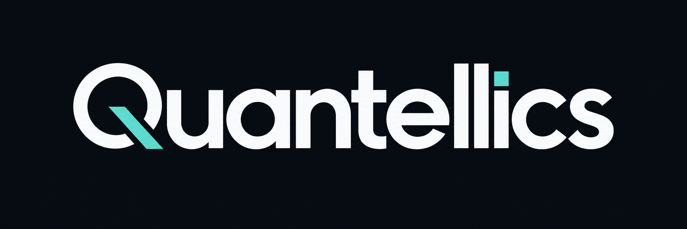
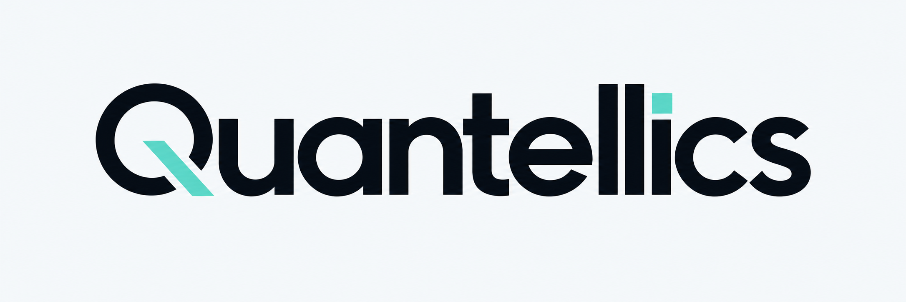

# Quantellics wordmark

The repository identity uses a geometric Quantellics wordmark with a mint diagonal Q stroke and a mint square above the i. The accent shape remains mint in both editions; lettering reverses between light and dark. Maya remains the game product name.

## Dark edition

## Light edition

## Assets and use

| File | Format | Dimensions | Intended surface |
|---|---|---|---|
| [quantellics-dark.png](quantellics-dark.png) | PNG | 2172 × 724 | Dark repository or presentation surface |
| [quantellics-light.png](quantellics-light.png) | PNG | 2172 × 724 | Light repository or presentation surface |

The root README uses an HTML picture element and colour-scheme media queries to choose the edition. Both include their own backgrounds so the wordmark remains legible independently of the surrounding page. Keep the aspect ratio and clear space; avoid stretching or adding shadows.

The palette direction is deep navy `#080D14`, off-white `#F5F8FA` and mint `#47CDB3`. These are generated raster assets, not editable vector masters. The same mint square and Q detail establish continuity between the two backgrounds.

## Generation and review

Created with the built-in image-generation tool using the imagegen skill. The initial design was inspected and rejected for distressed edges. A targeted cleanup retained the letterforms and produced clean lettering. The user's subsequent request added light/dark variants and the square accent. Both final images were visually checked for exact spelling, square-dot placement, readability and consistent identity.

[Generation prompts and provenance](generation.json) preserve the exact initial, cleanup and variant instructions. Source images remain in the original generated-image directory; the two final project assets are copied here. No raster editing script or font substitution was used.
