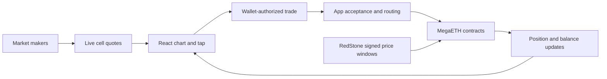

# Euphoria — stack, economics, flow and UX

**Euphoria combines a simple touch-grid interface with professional market-maker quotes, wallet authorization and oracle-backed settlement.** It remains the closest visual reference for our clip. We have not proven the file originated from Euphoria.

Related: [Tap Trading - Deep Research Index](Tap%20Trading%20-%20Deep%20Research%20Index.md), [Video Analysis - Price-Time Prediction Grid](Video%20Analysis%20-%20Price-Time%20Prediction%20Grid.md).

**User decision:** Euphoria is now the primary visual, interaction and functional reference. See [Euphoria - Product Reference and Fidelity Requirements](Euphoria%20-%20Product%20Reference%20and%20Fidelity%20Requirements.md) for the resulting requirements and explicit fidelity gaps.

**Follow-up verification:** [Euphoria - Paper Trading Implementation Plan](Euphoria%20-%20Paper%20Trading%20Implementation%20Plan.md) records newly extracted exact stake-menu values, tier filtering, zoom bounds/default and quote encoding, with a source-hashed facts file. These findings supersede earlier uncertainty about the client controls; authenticated runtime verification and the proprietary quote algorithm remain unavailable.

## Rules and current product configuration

**Documented:** each square covers a price band and a five-second window. The price only needs to touch once; it does not have to remain in the band. Unhit positions expire worthless. The guide gives a $0.10 default per-tap amount and web/PWA/Telegram access. Multipliers respond to distance, time and volatility. [How to tap trade](https://docs.euphoria.finance/euphoria/how-to-tap-trade).

The guide confirms our video's broad rule. It does not fully specify inclusive boundaries, sampling between oracle ticks, jump handling, late acceptance or outage settlement. Those require contract/oracle specifications.

The [FAQ](https://docs.euphoria.finance/euphoria/faq) currently describes ETH as supported and BTC/SOL as forthcoming. It says the login wallet differs from the generated embedded deposit wallet. Thus a BTC symbol in public code does not establish that BTC trading is enabled for every account.

## Verified frontend evidence

Inspected [main bundle](https://euphoria.finance/assets/index-CoMhH3ox.js), [trade module](https://euphoria.finance/assets/trade-DoSKuLAy.js), [client runtime](https://euphoria.finance/assets/client-runtime-ON1FWv3J.js) and [tRPC runtime](https://euphoria.finance/assets/trpc-runtime-AwfruwIr.js). URLs/hashes are retained in the request manifest.

| Layer | Direct evidence | Interpretation |
|---|---|---|
| Application | React vendor and Vite/Rolldown asset structure | React SPA with split route modules |
| Chart | Custom grid coordinate/state classes and Canvas 2D drawing functions | Application-specific chart renderer, rather than a conventional exchange chart widget |
| Motion | Rive runtime, `.riv` asset and WASM; separate drawing surfaces | Animated states are layered over chart graphics |
| Requests/events | tRPC runtime; NATS client; `wss://api.mainnet.euphoria.finance/_events` | Request/response commands plus streaming price, quote and position updates |
| Identity/support | Privy login; Sentry, Firebase messaging and Intercom-related code | Authentication, operational monitoring, notifications/support integrations |

No Three.js renderer was established. Merely finding WebGL code would not prove Three.js: Rive itself uses WebGL. Server language, database, deployment platform, market-maker strategy and order-book persistence remain unknown.

The chart code distinguishes data coordinates from screen coordinates and supports zoom/panning. Asset configurations for ETH/BTC/SOL are present, along with five-second cells, slippage protection and accidental-tap protection. Follow-up tracing found effective asset zoom bounds 0.345–0.9, a live-route fresh default 0.6 and wheel factors 1.1/0.9. These are continuous bounds, not a discrete preset list. The stake menu is 0.10/0.50/1/5/10/25/50, filtered by the supplied user's maximum trade size. Saved settings and server tier data still require runtime verification.

## Execution architecture

**Documented:** market makers supply live square quotes; the app shows the best available quote; smart contracts record/settle positions on MegaETH; RedStone supplies the settlement data. Users can constrain adverse multiplier changes with slippage tolerance. [Platform](https://docs.euphoria.finance/euphoria/about-the-platform), [architecture](https://docs.euphoria.finance/euphoria/architecture-and-technology).

This combines documented parties with observed client request/event structure. The exact matching-service implementation and where every validation executes are not verified.

Public code tracks a requested multiplier separately from the executed multiplier. It exposes provisional, confirmed and rejected position updates, as well as caps by square, column and user exposure. This supports a reconstruction in which a tap produces immediate visual feedback, then acceptance or rollback. It explains why our clip can briefly show a card or debit before rejection; it does not identify the exact reason for any historical rejection.

The [FAQ's error definitions](https://docs.euphoria.finance/euphoria/faq) distinguish missing quotes, slippage, rate limits, position limits and insufficient balance. The clip's generic rejection text alone cannot tell us which backend condition fired.

## Oracle engineering

RedStone's own [integration explanation](https://blog.redstone.finance/2026/01/13/euphoria-redstone-bolt/) describes sub-second price computation, fixed non-overlapping windows, signed latest/high/low feeds, MQTT delivery and DynamoDB persistence of signed outputs. These are details of **RedStone's integration**, not proof that Euphoria's application database is DynamoDB.

**Inference:** producing high/low values at the oracle layer prevents the UI's frame rate from deciding whether a touch occurred. But a high/low crossing and a sampled tick inside a band are not always equivalent when prices jump. A clone needs a formal rule for that case, plus exact window timestamps.

## Economics

The [current fee page](https://docs.euphoria.finance/euphoria/fees-and-trading-limits) states no trading commission. New-account limits are $5 per trade and $25 per square; standard limits are $10 and $50 respectively. It describes market-maker capacity as the reason for restrictions. It also specifies network/provider costs for funding or withdrawal, including a small USDM withdrawal gas charge. The FAQ's broader “no withdrawal fee” wording is less precise, so the dedicated fee page should guide comparison.

**Inference:** competitive quotes can include compensation for probability uncertainty, adverse selection, inventory and operating costs even when the platform charges zero explicit commission. We cannot infer the platform's net revenue, market makers' actual margin or revenue sharing from the fee page.

For the video, a $5 stake at 2.51× returns $12.55 gross: $7.55 profit if successful, minus $5 if unsuccessful. If the real hit probability were `p`, the expected player profit is `5 × (2.51p − 1)`. That formula is our derivation; it is not Euphoria's proprietary pricing algorithm.

A grid has correlated exposures: the same path may hit adjacent rows in one time column. Summing stakes is insufficient for a market maker's maximum-liability calculation. The exposed per-column/user limits make economic sense under that risk structure, though the exact server risk model is unavailable.

## User flow and UX

Observed public entry: branded landing → login modal → email, Google, Twitter, other-social or wallet choices. Privy branding is visible. No login was submitted. The remainder is documented or reconstructed from the supplied clip and public code:

1. Establish identity and embedded wallet.
2. Fund the account using the app's deposit route.
3. Set a reusable per-tap stake and inspect priced future cells.
4. Tap; see provisional feedback, then accepted odds or rejection.
5. Receive settlement feedback; inspect history/profile and share results.

The burgundy background, subdued future grid, white current-price trace and lime position cards create a clear visual hierarchy. The moving line is the focal point; selected cells remain visible as commitments. The same area conveys price, time, probability, money and outcome, reducing navigation but demanding careful legibility.

The historical clip shows compact stake cycling. The current public trade module instead opens a size picker and provides desktop Alt-number shortcuts. Our latest plan follows that current code and the user's exact-control request; the older clip is preserved as a separate replay fixture. Zoom affects inspection and hit testing without rewriting an accepted contract.

The code's provisional/confirmed separation is a useful pattern to copy. A wallet total must distinguish reserved from finalized debits so a rejected tap does not look like lost money. Celebrate wins only after the authoritative settlement state; a smoothed visual crossing is not proof.

Public landing-page reference:

## Contract and audit limits

The [audit page](https://docs.euphoria.finance/euphoria/smart-contract-audit) lists core contract `0xdf8248fee58e791149e69f6c61129D471EaFC11E` and a Sherlock report. Sherlock's own [researcher page](https://audits.sherlock.xyz/watson/TessKimy) lists a March 2026 Euphoria engagement, supporting the audit relationship.

The linked PDF returned HTTP 403, the explorer source page was unavailable to the fetcher, and the direct code-read RPC returned HTTP 403. Therefore **the report contents, remediation status and equivalence to current deployed bytecode were not reviewed**. Indexed explorer transactions show transfers to the documented address; they do not establish settlement correctness or contract safety.

## Takeaway for Maya

Copy the separation between chart, quotes, acceptance and settlement; the low-friction identity model; and the restraint of the visual hierarchy. Keep the original palette/interaction goals distinct from current account limits. Do not invent Euphoria's market-making algorithm, revenue, supported market rollout or authentication internals from a visual match.

## Pair clarification — 2026-09-20

The user clarified that they want **pairs**, not asset names. The [official FAQ](https://docs.euphoria.finance/euphoria/faq), re-read today, documents ETH supported and BTC/SOL coming soon. The chart's dollar-price interpretation and public client `dollarsPerLine` configuration support describing these in familiar pair terms as **ETH/USD**, with **BTC/USD and SOL/USD** corresponding to the announced assets. **Those slash-form symbols are our explanatory mapping, not an exact pair list published by Euphoria.** The public documentation does not establish an ETH/USDT exchange listing. No BTC/ETH cross market was verified. Authenticated live availability has not been independently checked.

The [RedStone integration article](https://blog.redstone.finance/2026/01/13/euphoria-redstone-bolt/) confirms aggregated exchange-sourced price feeds and asset feed IDs such as ETH, ETH_HIGH and ETH_LOW, but does not itself state the exact quote-currency symbol. Funding/settlement tokens must not be confused with chart quote currency. No change to Maya's previously selected three markets was made by this clarification.

## ETH dollar-price API availability — 2026-09-20

**No supported public Euphoria price API was found in the reviewed official documentation/index or searches.** This is a research result, not proof that partner access does not exist. The [documentation index](https://docs.euphoria.finance/llms.txt) does not establish a public developer price service.

The previously fetched [public main bundle](https://euphoria.finance/assets/index-CoMhH3ox.js) has an internal tRPC subscription, `prices.onPriceUpdate`, taking `symbol: chartConfig.asset`. Around source offsets 406673–406881 it is enabled only for live mode, an authenticated user, app access, an initialized grid and a subscribed game. Initial price history loading is also gated in client code. These are observed frontend conditions; server authorization was not tested. The previously identified NATS `/_events` connection supplies other app events/quotes and should not be advertised as a documented public ETH/USD endpoint.

[RedStone's Euphoria integration article](https://blog.redstone.finance/2026/01/13/euphoria-redstone-bolt/) confirms a custom Bolt setup with signed latest/high/low feeds and sub-second price processing. [RedStone Bolt's product page](https://www.redstone.finance/bolt) supports general integration and describes on-chain push feeds. Neither establishes anonymous third-party access to Euphoria's exact custom stream.

Separately, the official [redstone-api repository](https://github.com/redstone-finance/redstone-api) documents a JavaScript/HTTP price API, ETH support, USD-denominated values and no API key for that API. Its README is evidence of a separately documented interface, **not a live availability/latency test or proof of Euphoria-feed equivalence**. No SDK installed and no endpoint connected in this turn. The April 2025 Bolt launch article is historical; its testnet-only wording is not treated as current rollout status.

For Maya, direct RedStone integration is a possible way to investigate matching the price source, pending confirmation of exact feed, delivery, sampling/windows and access. It does not provide Euphoria's market-maker odds. This question does not supersede the user's current Wintermute-first provider preference. No external inquiry sent.
