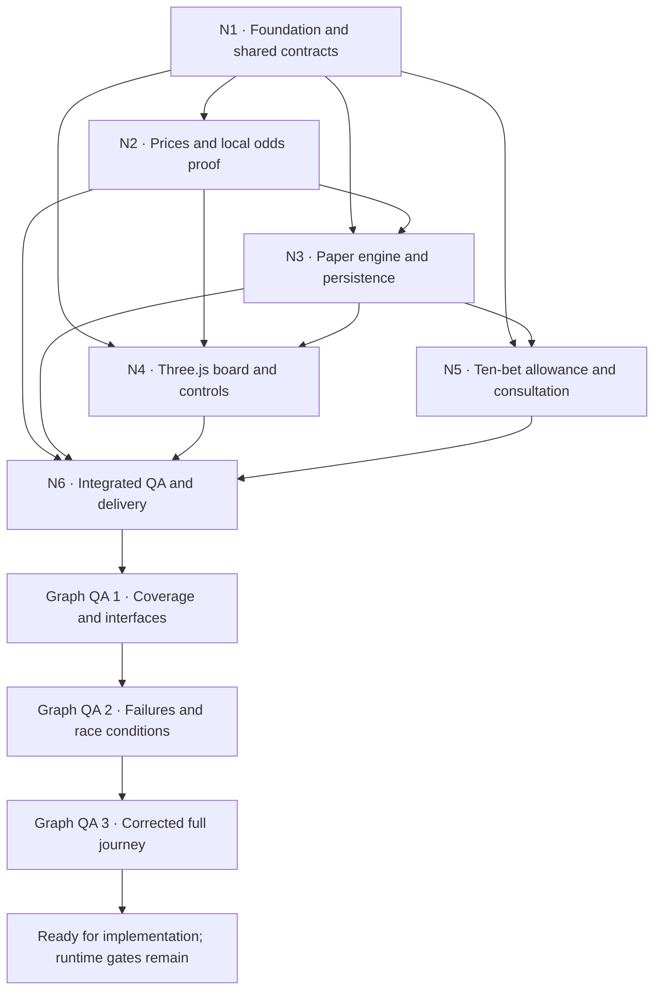

# Maya development graph

Build Maya as an immediately playable, Euphoria-style white-label sales demo: BTC/USD and ETH/USD, real public Lynx price inputs, local indicative paper odds, ten accepted bets per page load, and a Maya consultation message after the tenth. Every refresh permits ten more bets. The consultation URL is the approved dummy `https://example.com`.

**Added user requirement:** a monorepo with distinctly optimized adaptive desktop, tablet and mobile experiences. [Maya - Monorepo and Adaptive Layouts](Maya%20-%20Monorepo%20and%20Adaptive%20Layouts.md) specifies the package graph and presentation boundary. The affected node agents repeat their three review passes for this amendment before whole-graph QA.

**This deliverable is a development plan.** The user requested subagents and three QA loops at node and graph levels. Six bounded node plans receive three documented planning-review passes each, then the assembled graph receives three sequential cross-node reviews with corrections between passes. Runtime tests and live model integration are future implementation gates, not results established by reviewing this plan.

**Later execution request:** “once done, host it in docker desktop” extends the task to implementing this graph and serving the built demo locally with Docker Compose. [Maya - Implementation and Docker Delivery](Maya%20-%20Implementation%20and%20Docker%20Delivery.md) records that work separately. The planning reviews below remain planning evidence; subsequent runtime tests must earn their own results. N1 foundation can start independently while the final assembled-plan review concludes.

Authority: [V1 - Locked Product Scope](V1%20-%20Locked%20Product%20Scope.md), [V1 - White-label Demo and Consultation Flow](V1%20-%20White-label%20Demo%20and%20Consultation%20Flow.md), [Euphoria - Paper Trading Implementation Plan](Euphoria%20-%20Paper%20Trading%20Implementation%20Plan.md), [Euphoria - Product Reference and Fidelity Requirements](Euphoria%20-%20Product%20Reference%20and%20Fidelity%20Requirements.md). Exact evidence versus chosen demo defaults stays visible in N1. Historical provider plans do not override these decisions.

## Dependency graph

Every node contains the loop `draft → review → correct → recheck`, applied three times. Dependency arrows mean that final integration/acceptance needs the upstream contract; static UI scaffolding and deterministic engine fixtures may be developed earlier against explicit mocks. No fixture may silently replace public data in prospect-facing live mode.

Open the companion **Maya - Development Graph.canvas** in Obsidian to navigate the node notes spatially. The machine-readable graph and review manifest are retained under `Attachments/Maya Development/`.

## Node ownership and output

| Node | Plan owner | Output and exit gate | Node plan |
|---|---|---|---|
| N1 | Foundation subagent | Monorepo workspace/package/task graph, versioned configuration, pinned implementation toolchain, shared schemas, source/default provenance and test contract. | [Maya Development - N1 Foundation](Maya%20Development%20-%20N1%20Foundation.md) |
| N2 | Market/model subagent | Read-only adapter and local model proof for both exact market geometries; fail closed on invalid inputs, with usable valid cells required. | [Maya Development - N2 Prices and Odds](Maya%20Development%20-%20N2%20Prices%20and%20Odds.md) |
| N3 | Engine subagent | Atomic paper ledger/acceptance, sampled settlement, recovery and persisted state, including quota integration contract. | [Maya Development - N3 Paper Engine](Maya%20Development%20-%20N3%20Paper%20Engine.md) |
| N4 | Experience subagent | Calibrated Three.js scene plus distinct adaptive desktop/tablet/mobile compositions, shared coordinate transform, safe input and legible feedback. | [Maya Development - N4 Playable Experience](Maya%20Development%20-%20N4%20Playable%20Experience.md) |
| N5 | Sales-flow subagent | Document-memory allowance and Maya modal, exact tenth-bet transition, approved dummy CTA and unlimited refresh retries. | [Maya Development - N5 Consultation Flow](Maya%20Development%20-%20N5%20Consultation%20Flow.md) |
| N6 | Integration subagent | Workspace assembly, three runtime QA rounds planned across all three profiles, evidence package, repeatable build and shareable-preview procedure. | [Maya Development - N6 Integration and Delivery](Maya%20Development%20-%20N6%20Integration%20and%20Delivery.md) |

The coordinator owns this graph, requirement coverage, shared decisions, Canvas and graph QA log. Node agents own their named note only. Corrections across boundaries are routed through the coordinator, avoiding concurrent edits to shared contracts.

## Requirement-to-node coverage

| ID | Requirement | Owners | Acceptance evidence required during implementation |
|---|---|---|---|
| R01 | Maya public identity; Euphoria visual/interaction reference | N1, N4, N5 | Visible Maya branding and approved consultation copy; source-reference comparison. |
| R02 | Only BTC/USD and ETH/USD, no signup or external trading | N1, N2, N4 | Both selectors work with correct source identity; no account/order path. |
| R03 | Lynx-only public data, freshness and clock alignment | N2, N3 | Timestamped feed captures, outage/recovery report and source identity validation. |
| R04 | Local indicative odds, supported domain, exact accepted displayed payout | N2, N3, N4 | Model version/provenance, precise quote examples and supported-cell coverage proof. |
| R05 | Five-second cells, BTC $10 / ETH $0.50 bands | N1, N2, N3, N4 | Exact cell geometry tests, supported model input evidence, correct picking. |
| R06 | Zoom .345–.9, initial .6, factors1.1/.9, continuous pinch | N1, N4 | Min/default/max/wheel/pinch checks; no change to existing contracts. |
| R07 | Shared stakes $0.10/$0.50/$1/$5/$10; $50 per square | N1, N3, N4 | Every amount/select endpoint; no tiers; caps and insufficient funds enforced. |
| R08 | Draft default $1,000 funds/refill and $1 selected stake | N1, N3, N4 | Initialization/refill, exact cents, no quota reset or altered open bets. |
| R09 | Source-sampled touch; inclusive band; time [start,end); no RNG | N2, N3, N4 | Hit/miss/boundary/jump fixtures, authoritative hit marker, no interpolation wins. |
| R10 | Frozen terms; one-tap local placement; no confirmation/slippage form | N3, N4 | Quote-age race, visible acknowledgement, immutable positions. |
| R11 | Reload preserves ledger; tabs cannot corrupt shared balance | N3, N5 | Restart/concurrent-tab transaction and idempotent settlement evidence. |
| R12 | Ten accepted new placements per document, rejected/retried taps excluded | N3, N5 | Ninth/tenth/eleventh and rapid-click cases with ledger/count reconciliation. |
| R13 | Consultation after tenth acceptance; existing bets finish | N3, N4, N5 | Modal/clock independence, dismissal, behind-modal outcome evidence. |
| R14 | Every refresh grants ten more; no persisted visitor quota | N3, N5 | Repeated refresh, hydrated positions, cross-pair and refill cases. |
| R15 | Maya offer, source handover, dummy example.com CTA; details outside game | N1, N5, N6 | Copy review and explicit-click link navigation; no fake booking success. |
| R16 | Distinct adaptive desktop/tablet/mobile usability; safe gestures and persistent state across profile changes | N1, N4, N5, N6 | All three profiles, input capabilities, portrait/landscape and breakpoint-transition evidence. |
| R17 | Continuous chart, bounded resources, visible unavailable states | N2, N4, N6 | Measured frame/resource report and stale/unavailable demonstrations. |
| R18 | Historical reference replay remains separate and bypasses sales gate | N4, N6 | Measured visual checkpoints and original 13-position ledger fixture. |
| R19 | Clean runnable monorepo, package/task boundaries, preview procedure and full demo source package | N1, N6 | Workspace lockfile/exports, cold build and cache invalidation, uncached live/E2E evidence, handoff inventory and reproducibility. |
| R20 | No new provider, live-money execution or buyer-specific chain setup | All | Scope audit and source/network/dependency inspection. |

## Shared integration decisions

The implementation location is the monorepo `<repo>`; the Obsidian vault holds plans, source references and QA artifacts. `apps/demo` composes the six shared packages defined in [Maya - Monorepo and Adaptive Layouts](Maya%20-%20Monorepo%20and%20Adaptive%20Layouts.md). pnpm workspaces/Turborepo orchestrate the TypeScript/Vite/Three.js application with synchronized HTML controls. Package versions will be verified/pinned when scaffolding begins; this plan does not guess future versions or add a UI framework by habit. Keep a single engine, source subscriptions and document allowance through every adaptive layout transition.

N1 owns canonical types and configuration. N2 owns normalized samples, model/config validation, clock/freshness status and immutable quote snapshots. N3 owns the authoritative acceptance coordinator, persisted ledger, recovery and settlements. N4 reads snapshots and emits input intents; graphics never credit money. N5 provides a page-local allowance to N3 and reacts to committed acceptance events; the modal cannot pause the engine. N6 integrates and verifies these contracts together. N2's canonical model coverage and N4/N6's actual visible-cell coverage are distinct mandatory gates. N4/N5 isolated harness handoffs precede N6; real board/modal/storage journeys are downstream release checks and do not create reverse dependencies.

Displayed gross odds are fixed in hundredths. N2's observed preview flooring must be preserved with deliberate numeric handling; N3 rounds the final gross payout once, half-up to integer cents. A bet at $5 and 2.5× credits $12.50 on a win. The full exact decimal/source representation and payload fields are defined by N1/N2/N3, not independently invented by the renderer.

Use a persisted origin-local ledger with atomic transactions and per-document serialized placements. The allowance stays only in document memory. Persist the debit/position before incrementing the page allowance, and increment before releasing the placement queue or emitting the accepted event. A crash after commit creates a new document on reload and therefore a fresh allowance by design; restoring that position must not count or debit again. Cross-tab transaction policy belongs to N3.

## QA loops and honest status

| Level | Pass 1 | Pass 2 | Pass 3 |
|---|---|---|---|
| Each node plan, executed in this planning turn | Requirements, source evidence and dependencies | Adversarial cases and interface failures | Re-read corrections, coverage and handoff consistency |
| Whole plan graph, executed after assembly | Reachability, ownership and end-to-end coverage | Cross-node races, timing, lifecycle and failure paths | Recheck corrected graph, defaults and delivery readiness |
| Each implemented node, required in future build | Focused contract/component tests | Boundary/failure/input tests | Corrected regression and node handoff evidence |
| Integrated running graph, required in future build | Complete happy-path demo journey | Outage/reload/multi-tab/quota/quote-race journey | Final regression plus visual/mobile/accessibility/performance review |

“Three passes” means three actual inspect/fix/recheck cycles with recorded findings, not a generic instruction repeated three times. A completed planning review never changes runtime status from `NOT RUN`. Each future failed gate routes to the responsible node, followed by focused correction/retest and the affected downstream journey; do not blindly rerun unrelated tests or claim release on a third failing attempt.

Graph-review results and revisions are recorded in [Maya - Graph QA Log](Maya%20-%20Graph%20QA%20Log.md). Node-specific review records live in their notes. The release graph cannot be marked implemented or shipped solely because all review boxes are filled.

## Critical feasibility gate and execution order

1. Complete N1 settings/contracts and N2 read-only feed/model proof. Verify both live pairs, exact geometry, sample cadence, table domain and quote usefulness. ETH $0.50 is a local adaptation; the saved Lynx config does not list it as a live-server step.
2. Build N3 with deterministic fixtures and validated live inputs. In parallel, N4 can calibrate static visual geometry against the reference. The pricing proof must pass before declaring live play usable.
3. Connect N4 and N5 through N3's single acceptance path; preserve running settlement behind the sales modal and across pair changes.
4. Run N6's planned node/integrated QA cycles, reference comparison and source/package checks. Resolve failures at the owning node.
5. Produce a runnable demo and serve the built artifact locally through Docker Desktop/Compose on a free `127.0.0.1` port, as subsequently requested. Verify the actual container URL and preserve reproducible source/start/stop instructions. No public publishing is required by this local hosting request.

If feed/model compatibility fails, record the exact failure and affected node rather than quietly replacing Lynx, changing the markets/bands, or inventing market-maker odds. Work that is independent of that gate can continue, but live demo readiness remains unproven.

## Playable implementation

The implemented local Docker demo, source and runtime QA evidence are linked from [Maya - Start Here](Maya%20-%20Start%20Here.md). Planning review records above remain historical and are not substituted for runtime proof.
