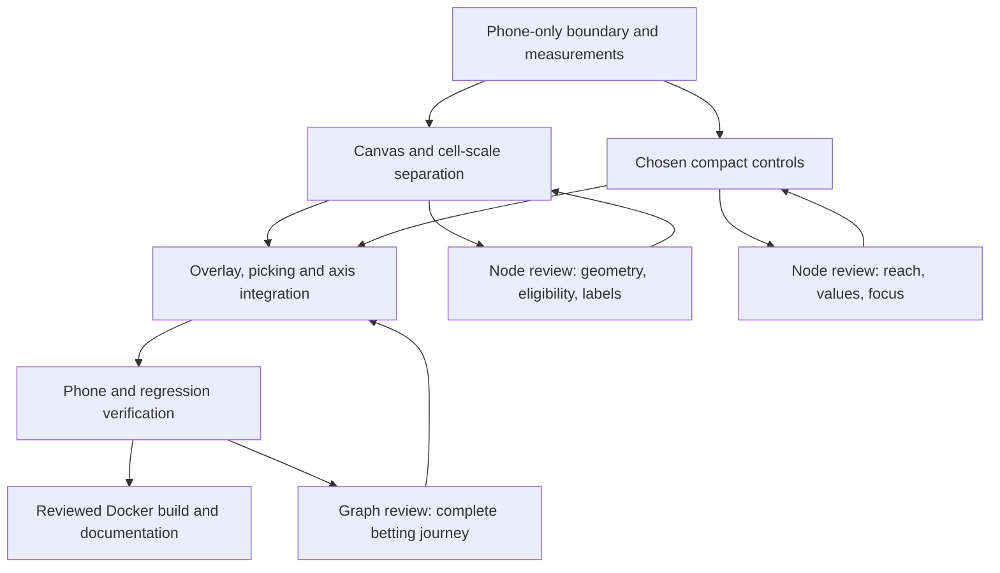

# Maya — mobile gameplay layout proposal

**Decision, 22 September:** the user selected alternative 2, the single-row thumb bar, and explicitly required pinch zoom. See [Maya Runtime - Mobile Thumb Bar and Pinch Zoom](Maya%20Runtime%20-%20Mobile%20Thumb%20Bar%20and%20Pinch%20Zoom.md) for implementation, the gauntlet loop and delivery. The proposal below is retained as its original design record.

**Proposal only. Desktop and tablet layouts must remain unchanged.** The user requested a plan and rendered concepts because balance/stake controls consume too much phone space. They then suggested moving every lower-panel button into a bottom-left burger menu, or providing four more alternatives. They authorised inspection/experimentation with the Docker instance and explicitly clarified that the redesign is only for mobile.

## What the current implementation shows

Inspected the current source at commit `eb7ec5b` and the running Docker application on 22 September 2026. Both web and relay containers were healthy. Used a separate browser session at 390 × 844 CSS pixels, without placing bets or refreshing the user's browser tab.

- Actual canvas bounds: x 0, y 196.453125, width 390, height 373.0625; bottom 569.515625.
- Actual bottom panel: x 12, y 712, width 366, height 120; bottom 832.
- Persistent board instruction: y 85, height 13. Separate navigation also occupies space above the footer.
- The footer is only one cause. `packages/game-ui/src/geometry.ts` caps chart height using available future horizontal distance and the provider-derived horizon. `index.ts` vertically centres the capped phone canvas and uses its height to calculate square size. Simply hiding the footer can therefore leave the canvas almost the same height, surrounded by blank space.
- `layout.ts` reserves space for the footer/navigation. The existing profile resolver also considers very short viewports mobile; a new compact phone layout must not inadvertently change tablet or desktop layouts through that shared condition.

The measurement is for an emulated browser viewport with no physical-device safe-area inset. It is not a device performance or real-phone usability certification.

## Five concepts

| Concept | Visible while playing | Expanded controls | Main trade-off |
| --- | --- | --- | --- |
| 1. Bottom-left burger — user's suggestion | 52 px menu button and noninteractive selected-stake readout; balance in header | Anchored panel containing stake presets, MIN/MAX, stake stepping, zoom, paper funds, navigation and secondary actions | Most open chart; changing a hidden setting requires opening the menu |
| 2. Single-row thumb bar | Menu, stake minus, selected stake, stake plus, zoom trigger in one compact row | Presets/MIN/MAX and secondary actions in popovers | Fastest stake changes; still reserves a slim strip |
| 3. Two corner controls | Stake at bottom left and zoom at bottom right | Each opens its own panel, with access to all controls | Clear centre and explicit controls; settings require another tap |
| 4. Collapsible drawer | Thin full-width stake/zoom summary strip | Bottom drawer with all controls; tap to open, optional swipe enhancement | Easy discovery; expanded drawer temporarily covers part of the game |
| 5. Vertical thumb rail | Menu, stake plus, current stake, stake minus, zoom on the left edge | Popovers for detailed options | Avoids a full-width footer but covers historical chart space and needs more thumb travel |

**Recommendation for the user's current priority: concept 1.** Retain the chosen stake beside the menu and the balance in the compact header so the amount spent by a square tap is never hidden. Concept 2 is the stronger option if one-tap stake adjustment is more important than maximum visual openness. This recommendation is design judgement, not a measured usability result.

Rendered concepts use illustrative prices, multipliers, selected positions and history. They are not live market data, pricing-model output or an alternative betting engine. The interactive preview supports layout switching, menu opening, exact stake presets, bounded zoom readouts, pair switching and closing controls. It does not execute bets. Zoom controls preview the settings; the concept chart is schematic rather than a live zoom/settlement renderer.

### 1 — Bottom-left burger

### 2 — Single-row thumb bar

### 3 — Two corner controls

### 4 — Collapsible drawer

### 5 — Vertical thumb rail

## Implementation plan after selecting a concept

1. **Create a phone-only layout boundary.** Keep desktop and tablet CSS, camera projection and control placement unchanged. Include phone rotation explicitly; do not rely only on the existing height-under-500 mobile profile rule. Compact the phone header: pair and current price on the left, paper balance on the right, recent-results trigger. Replace permanent instructional text with dismissible onboarding/help. Help and wallet remain adjacent inside the secondary controls.
2. **Separate canvas height from cell scale on phones.** Let the canvas fill the space between compact header and safe-area controls. Derive square size from a stable width/horizon reference and the existing zoom value instead of the full new canvas height. Use the extra vertical canvas for more price bands. Preserve square geometry, five-second windows, canonical price bands, lead-time eligibility and the displayed price path. The full scene can be taller without pushing future squares offscreen. Target approximately 650 px of chart plot height in a 390 × 844 app viewport, subject to safe areas and final axis/control placement; this target is not a delivered measurement.
3. **Implement the chosen control arrangement.** Preserve stakes $0.10, $0.50, $1, $5, $10; MIN/MAX and exact selected-stake addition on every accepted click; zoom 0.345–0.9, initial 0.6, existing 1.1/0.9 button factors. Preserve the $50 per-cell cap, source/odds/settlement contracts, $1,000 refresh balance and ten-play consultation flow. Do not replace the odds provider or change economic rules for this layout work.
4. **Make overlays stable and safe to tap.** Opening controls must not move/rescale the chart. Block new board input behind menus while the price feed and existing-bet settlement continue. Support dismissal, focus restoration, Escape, reduced motion and browser safe areas. Keep 44 px control targets. Do not enlarge adjacent square hit regions into each other; retain the accessible next-square path when grid cells are smaller at low zoom. Recent plays stay an overlay with five entries maximum. Keep timestamps separate from result text and compact navigation.
5. **Verify and document before Docker delivery.** Check 320 × 568, 360 × 640, 390 × 844, 430 × 932 and phone landscape 844 × 390 / 932 × 430. Test stake increments, zoom boundaries, overlay hit blocking, rapid repeated clicks, result display, ten-play consultation and refresh. Compare tablet 768 × 1024 / 1024 × 768 and desktop 1440 × 900 against existing layout baselines. Inspect real mobile-browser safe areas and rotating with open positions when hardware is available.

## Dependency graph and planned review loops

If this proposal is implemented, the three planned review passes are: (1) structural layout and source review, (2) interaction/engine regression review, and (3) independent end-to-end device and Docker review. Run node and graph corrections only where evidence calls for them. These future implementation reviews have **not** occurred in this planning session.

## Concept verification and limitations

[Concept review record](Attachments/Maya%20Mobile%20Concepts/review.json) · [Narrow dark preview](Attachments/Maya%20Mobile%20Concepts/burger-dark-320.png) · [Narrow light menu](Attachments/Maya%20Mobile%20Concepts/menu-light-320.png)

- Inspected the shipped mobile screenshot and current Docker geometry; no runtime source or Docker image was changed.
- Created five interactive phone mockups in the conversation, with product-specific light/dark styling and an optional host layout selector.
- Browser-checked all five concept states, expanded menu, $5 selection followed by a $10 increment, Escape dismissal and disabled maximum-stake controls. Checked narrow 320 px conversation rendering and both theme settings. The conversation shell reduces the enclosed phone to approximately 288 px at that host width; this is distinct from a 320 px production app viewport.
- Preview rendering initially refused to overwrite its existing temporary wrapper; reran with the renderer's `--force` option. Agent-browser could interact using frame-aware element references but its explicit frame-selector command failed. Used accessible snapshots and screenshots for concept inspection rather than claiming DOM-in-frame measurement checks.
- Source markup validation and browser console inspection are recorded with the archived concept evidence. Final screenshot labels are concepts, not before/after production evidence.
- Preview review found two issues and corrected them: the thumb bar initially covered the timeline labels, so the axis was moved above the control bounds; a host state echo initially closed the open menu after a stake change, so unchanged state echoes are now ignored. Rechecked the menu remaining open with $5 selected and the zoom readout changing from 0.6 to 0.66. These were concept-only fixes.

Implementation remains pending a layout choice. No live betting rules, balance state in the user's tab, desktop view, tablet view, API integration or app source were modified.

Related: [Maya - Monorepo and Adaptive Layouts](Maya%20-%20Monorepo%20and%20Adaptive%20Layouts.md), [Maya Runtime - Adaptive Layout Refinement](Maya%20Runtime%20-%20Adaptive%20Layout%20Refinement.md), [Maya Runtime - Bet Integrity and Leaderboard](Maya%20Runtime%20-%20Bet%20Integrity%20and%20Leaderboard.md), [Maya - Planning Debug and Results Index](Maya%20-%20Planning%20Debug%20and%20Results%20Index.md).
