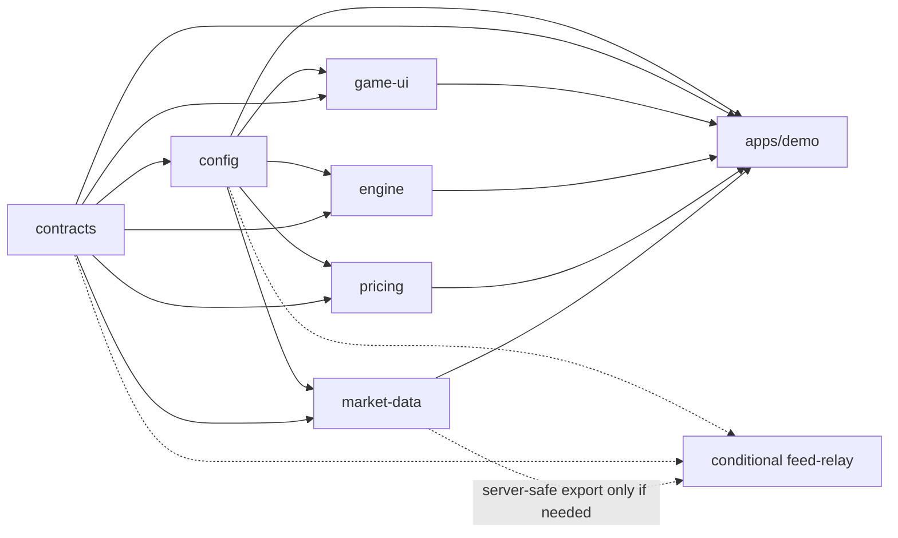

# Maya monorepo and adaptive layouts

**User requirement:** “create it as a monorepo, distinctly optimised for desktop, tablet and mobile views adaptively.” This updates the development graph while preserving the selected markets, pricing model, paper settlement and consultation flow.

Related: [Maya - Development Graph](Maya%20-%20Development%20Graph.md), [Maya Development - N1 Foundation](Maya%20Development%20-%20N1%20Foundation.md), [Maya Development - N4 Playable Experience](Maya%20Development%20-%20N4%20Playable%20Experience.md), [Maya Development - N6 Integration and Delivery](Maya%20Development%20-%20N6%20Integration%20and%20Delivery.md). N1 is authoritative for workspace/package contracts; N4 defines adaptive presentation profiles; N6 verifies the combined behavior.

## Repository shape

Monorepo root: **`<repo>`**, separate from the Obsidian vault. Use pnpm workspaces and Turborepo as the planning choice; verify/pin the exact supported versions and lockfile during scaffolding. One adaptive web application consumes shared packages. Desktop, tablet and mobile are distinct presentations of the same engine, not separate duplicated implementations of the betting rules.

```text
trading-game/
  apps/
    demo/                 @maya/demo: Vite entry, composition, lifecycle, sales flow, E2E
    feed-relay/           conditional: only if the public browser feed needs a relay
  packages/
    contracts/           @maya/contracts: DTOs, exact decimals, shared units and ports
    config/              @maya/config: defaults, provenance, branding, layout settings
    market-data/         @maya/market-data: read-only Lynx feed, timing, health, coverage
    pricing/             @maya/pricing: local model adaptation and quote registry
    engine/              @maya/engine: ledger, acceptance, settlement and persistence
    game-ui/             @maya/game-ui: Three.js scene, HTML controls, adaptive views
  artifacts/verification/
  docs/
  package.json
  pnpm-workspace.yaml
  pnpm-lock.yaml
  turbo.json
```

The conditional relay is not an automatic production backend commitment. No dedicated app is created for each viewport class, and no chain/liquidity configurator or separate marketing site is added to this demo.

## Package dependency graph

Arrows below point from a dependency to its consumer. Market services, quote services and engine instances are passed into the app composition through shared ports; package imports do not form a cycle.



Enforce public exports and `workspace:*` dependencies. Shared packages cannot import `apps/demo` or one another's private source paths. The UI receives read-only state and emits intents; it does not instantiate a second engine or mutate the ledger. The engine's storage adapter can live inside its browser-specific export without leaking browser-only imports into the relay.

Use compiled ESM and type exports consistently. N1 defines package task dependencies and cache inputs/outputs. Use local caching for deterministic work, with live provider probes, browser end-to-end runs and QA evidence generation explicitly uncached. A cache hit must never be reported as a fresh live-provider observation.

## Three adaptive experiences

| Experience | Distinct optimization | Invariants |
|---|---|---|
| Desktop | Reference-calibrated chart proportions, precise pointer/hover feedback, wheel zoom and keyboard control; full visible controls where space permits. | Same market/time/band rules, exact quotes, stakes and paper state. |
| Tablet | Touch-friendly controls and spacing, portrait/landscape composition, pen/mouse where present, readable quotes without relying on hover. | Rotation/resizing does not reset the engine, open bets or ten-bet count. |
| Mobile | Thumb-reachable controls, safe-area/short-height handling, compact result presentation and accessible consultation sheet/dialog; deliberate tap versus pan/pinch discrimination. | Same bet eligibility and terms; no zoom beyond researched limits or hidden market/stake change. |

Choose presentation by available layout space and input capabilities, not user-agent labels. Exact profile thresholds and interaction dimensions are **Maya implementation defaults**, not recovered Euphoria settings; N4 supplies the canonical values and measured validation. Narrow desktop windows and touch-capable wide screens must remain usable. Re-evaluate profiles when viewport/container, orientation or input capabilities change.

N4's proposed canonical selection order is: **compact** when width <768 CSS px or usable height <500 px; otherwise **tablet/medium** when width <1200 px or when the primary pointer is coarse and width <1440 px; otherwise **desktop/wide**. Pointer/hover behavior is still assessed separately. Test on both sides of every boundary, including short landscape windows and wide touch screens. These profile names describe presentation, not a claim to identify physical devices.

Keep control touch targets at least the proposed 44 CSS px. The preserved chart formula can yield smaller cells at minimum zoom on small screens; never enlarge neighboring cell hitboxes so that they overlap or place an unintended bet. Use the exact inverse view transform plus accessible cell navigation, and report the measured small-screen tradeoff in N4's fidelity record.

Keep one engine, source subscription set, persisted ledger, document allowance and canonical world-coordinate system alive through layout transitions. Reposition UI and update the view transform in place. Cancel an unfinished placement gesture when a layout transition invalidates its hit test rather than submitting to a moved square. Existing contracts never move in market/time coordinates because the viewport changed.

The Euphoria zoom bounds still apply in all profiles: 0.345–0.9, default 0.6, recovered wheel factors 1.1/0.9 and bounded continuous pinch. If a small viewport makes cells difficult to target, adapt surrounding chrome and valid input affordances; do not silently change cell durations, price bands, stake limits or accepted terms.

The chart rectangle is sized separately from the host that selects a profile. N4 defines a maximum-height/future-horizon rule using the measured source-age bound, lead cutoff and two complete eligible windows at maximum zoom. Extra portrait space supports controls/results. ModelCandidateCoverage uses a fixed canonical set independent of the screen; ViewportPlayableCoverage tests actual complete, readable cells in each view. A passing model check cannot stand in for a playable mobile board. See N4 for formulas, clipping and navigation.

## QA implications

The monorepo amendment is included in the node review records and all three sequential graph reviews. N1 rechecks package ownership, dependency/export boundaries and task caching. N4 rechecks the three presentations and transition safety. N5/N3 preserve page-versus-ledger lifetime. N6 runs the future runtime plan across all three profiles, portrait/landscape and breakpoint transitions.

During implementation, verify a cold workspace install/build, dependent-package invalidation after a shared change, no app/private-path imports from shared packages, and uncached fresh evidence for live/browser checks. Repeat the complete pair → stake/zoom → accepted bet → result → tenth-bet consultation → refresh flow in each profile. Emulated viewports are reported as emulation; do not claim physical tablet/phone testing without performing it.

**Planning only:** no monorepo packages have been scaffolded, application code built or device/browser QA run in this turn. The graph and node specifications define those implementation tasks.
