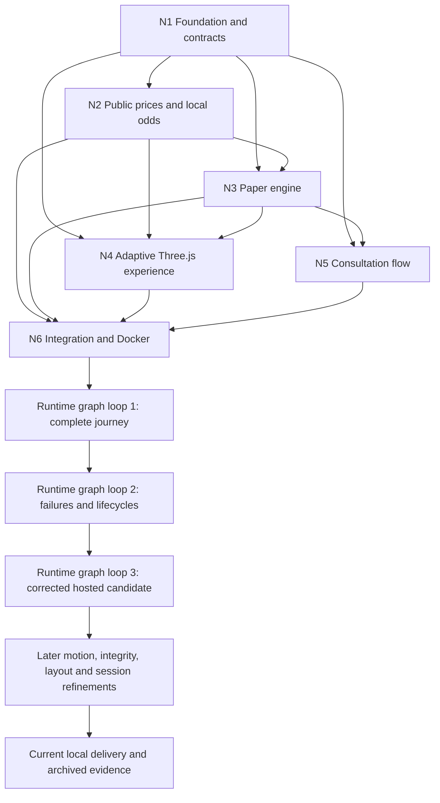

# Maya planning, debugging and results

Maya is implemented and running in Docker Desktop at http://127.0.0.1:8080. This index connects the original graph, each node's three review loops, debugging evidence and later corrections. Original plans and failed checks remain historical records; their planning PASS labels do not mean runtime tests passed.

The latest UI/input work is in [Maya Runtime - Mobile Thumb Bar and Pinch Zoom](Maya%20Runtime%20-%20Mobile%20Thumb%20Bar%20and%20Pinch%20Zoom.md); the earlier [Maya Runtime - Wallet Controls and Fresh Sessions](Maya%20Runtime%20-%20Wallet%20Controls%20and%20Fresh%20Sessions.md) defines the independent $1,000/ten-play refresh behavior. Current wallet/consultation destination is https://quantellics.com; the original example.com destination is historical. Current source is the Q-Maya monorepo.

## Graph and review sequence

Each node used review → correction → recheck three times. The original planning phase recorded 18 node passes, 12 additional adaptive/monorepo amendment passes across N1/N4/N5/N6, and three sequential assembled-graph reviews. N2/N3 received contract/package reconciliation and the graph reviews for that amendment. These counts describe completed planning reviews, not new tests performed during this documentation export.

[Maya - Development Graph](Maya%20-%20Development%20Graph.md) preserves the requirement map and original dependency plan. [Maya - Graph QA Log](Maya%20-%20Graph%20QA%20Log.md) links the three frozen input snapshots and full independent reviews. The companion [Obsidian Canvas](Maya%20-%20Development%20Graph.canvas) preserves the spatial plan. Its original text remains a planning snapshot.

## Node plans and executed loops

| Node | Plan and three planning reviews | Runtime correction/recheck record | Result at the node handoff |
|---|---|---|---|
| N1 | [Maya Development - N1 Foundation](Maya%20Development%20-%20N1%20Foundation.md) | [Maya Runtime - N1 Foundation](Maya%20Runtime%20-%20N1%20Foundation.md) | Three rounds; 41 contract/config tests, boundary negative fixture and uncached isolated build passed. |
| N2 | [Maya Development - N2 Prices and Odds](Maya%20Development%20-%20N2%20Prices%20and%20Odds.md) | [Maya Runtime - N2 Prices and Odds](Maya%20Runtime%20-%20N2%20Prices%20and%20Odds.md) | Three rounds; 24 focused tests plus independent model/convergence checks. Published-table event compatibility failed and was replaced with an explicitly local model. |
| N3 | [Maya Development - N3 Paper Engine](Maya%20Development%20-%20N3%20Paper%20Engine.md) | [Maya Runtime - N3 Paper Engine](Maya%20Runtime%20-%20N3%20Paper%20Engine.md) | Three rounds progressed through 7, 17 and 24 passing deterministic cases after recorded failures; later integration added retention and v2/session checks. |
| N4 | [Maya Development - N4 Playable Experience](Maya%20Development%20-%20N4%20Playable%20Experience.md) | [Maya Runtime - N4 Playable Experience](Maya%20Runtime%20-%20N4%20Playable%20Experience.md) | Three fixture/browser correction rounds plus later deployed label-fit checks. Live-source and engine proof belongs to N6. |
| N5 | [Maya Development - N5 Consultation Flow](Maya%20Development%20-%20N5%20Consultation%20Flow.md) | [Maya Runtime - N5 Consultation Flow](Maya%20Runtime%20-%20N5%20Consultation%20Flow.md) | Three rounds; 15 isolated controller/browser checks passed after lifecycle, acknowledgement and gesture fixes. |
| N6 | [Maya Development - N6 Integration and Delivery](Maya%20Development%20-%20N6%20Integration%20and%20Delivery.md) | [Maya Runtime - N6 Integration and Docker](Maya%20Runtime%20-%20N6%20Integration%20and%20Docker.md) | Three integrated runtime rounds; initial final build passed 95 unit tests and 267 exact checks across 41 live settled positions. Later revisions below supersede build identity and session semantics. |

The runtime graph loops covered the complete live journey, outages/reload/multi-tab lifecycles, then the corrected Docker candidate and independent composition review. [Maya Runtime - N6 Independent Review](Maya%20Runtime%20-%20N6%20Independent%20Review.md) is the independent input to the third integration round. Original shared-balance/tab behavior was valid at that revision and is superseded by the user's later refresh-reset request.

## Debugging record and resolutions

| Observed issue | Cause or finding | Correction and evidence |
|---|---|---|
| Planning coverage did not ensure visible mobile choices; consultation exit depended on downstream integration | Model coverage and viewport coverage were mixed; node exit gates were cyclic | Split the metrics and isolated N5 exit gates. Graph passes 2 and 3 rechecked the correction in [Maya - Graph QA Log](Maya%20-%20Graph%20QA%20Log.md). |
| Live fetch and initial builds failed | Native fetch receiver binding; mixed source encoding; unsupported Turbo flag combination; absent compiler API | Bound-safe fetch wrapper, UTF-8 correction, corrected build invocation and pinned parser. N1/N2/N6 reports preserve failures and rechecks. |
| Published touch table did not match the original five-sample event | A zero-width band had positive table probability; independent comparisons disagreed | Preserved the failed equivalence gate, implemented and verified local Gaussian quadrature; later v2 matches six connected observations. N2 and [Maya Runtime - Bet Integrity and Leaderboard](Maya%20Runtime%20-%20Bet%20Integrity%20and%20Leaderboard.md) distinguish numerical proof from market calibration. |
| Engine could misclassify incomplete/conflicted or future evidence | Conflict timing, completeness and clock validation gaps | Persisted conflicts, required complete eligible evidence, constrained source time and recovered durable samples. N3 includes before/after reports. |
| Apparent line touch could miss under the original settlement rule | Rendered connectors and stabilized sampled settlement described different events | New v2 bets use the same immutable observed path for chart and exact segment-intersection settlement. Old accepted bets retain old rules; the user's six recorded wins reconciled correctly. A specific apparent missed win could not be reconstructed conclusively. |
| Double/multiple clicks and hover amounts appeared inconsistent | Accepted stakes were correct; offer labels could lag the stake selector by 160ms | Synchronous label refresh and grouped immutable legs. All five stakes × four click counts × three viewports passed 60 amount checks; a separate four-click live $5 sequence passed 33 debit checks. |
| Chart hitches and overlapping results/timestamps | Repeated layout reads and numerical pricing on the UI thread; panel occupied chart space | Batched measurements, dedicated pricing Worker, top-left translucent overlay, distinct timestamp styling and requested size reductions. Two final 20-second traces had 1,201 frames each, p95 16.8ms and no frames above 50ms on this host. |
| Consultation could acknowledge invisible or duplicate presentation | Detached host, disposal/microtask and reentrant acknowledgement races | Connected visible-host checks, retry/disposal guards, stable offer identity and gesture cancellation. N5's final 15 checks passed. |
| New controls CSS initially absent from build; two hover assertions failed | Explicit stylesheet copy list was incomplete; test focus already applied hover-equivalent colours | Added stylesheet to asset copying; neutralized focus in the measurement harness. Full build and all 53 final browser checks passed. |
| Refresh retained the old balance | Prior deliberate persistent-ledger design no longer matched the latest user request | Per-document ledger key grants $1,000 and ten plays on refresh; old records remain isolated for audit. Three new engine tests and real refresh checks passed. |

Raw reports retain failed attempts, intermediate asset identities, test-harness limitations and corrected reruns. The detailed chronology is in [Tap Trading Research - Search and Action Log](Tap%20Trading%20Research%20-%20Search%20and%20Action%20Log.md).

## Latest validation and historical results

The full mobile release check on22 September passed165 unit tests and three final Docker/public gauntlets (112/112/112 and113/112/112). The25 September handoff freshly inspected source, live/local containers and HTTP without rerunning gameplay. Maya - Agent Handoff - 2026-09-25 records the newer favicon commit and local/public page-shell difference. The figures below describe the earlier wallet/session release and must not be presented as fresh tests of a later revision.

- Wallet/session workspace check: **160 unit tests**, typechecks, package boundaries and production build passed at that revision. Engine count was43; older95/157 totals belong to earlier revisions.
- Latest Docker browser: **53 checks** across desktop 1642×904, tablet 768×1024, mobile 390×844, narrow mobile 320×740 and landscape 844×390. Wallet placement, contact navigation, focus containment, reduced motion, button feedback and refresh accounting were checked.
- Separate ten-bet journey: one consultation offer, ten settled losses and **141 exact ledger checks**; refresh returned $1,000, zero positions and ten plays. Earlier v2 live evidence includes wins and losses, with **365 exact checks across 27 positions** at that revision.
- Stake/grouping/streak and layout evidence: [Maya Runtime - Bet Integrity and Leaderboard](Maya%20Runtime%20-%20Bet%20Integrity%20and%20Leaderboard.md), [Maya Runtime - Adaptive Layout Refinement](Maya%20Runtime%20-%20Adaptive%20Layout%20Refinement.md), [Maya Runtime - Motion and Adaptive Refinement](Maya%20Runtime%20-%20Motion%20and%20Adaptive%20Refinement.md). Five recent plays maximum; latest requested panel width/font reductions are recorded there.
- Latest served assets: `index-C17uMyXW.js`, `index-CKtWwCWC.css` and `pricing-worker-B5eTPeMV.js`. Docker web and relay services are healthy. [Maya Runtime - Wallet Controls and Fresh Sessions](Maya%20Runtime%20-%20Wallet%20Controls%20and%20Fresh%20Sessions.md) is the current behavior report.

The original 95% BTC candidate-availability target remains a recorded failure; a revised 90% local-demo target was adopted explicitly. Later v2 numerical checks are independent of that historical sampled-model replay. The 111 planned acceptance cases were not all certified. Euphoria pixel/odds/sound identity, physical-device performance, empirical odds calibration and production market-maker execution remain unproved. This is a playable paper demo with Lynx public prices and simulated local odds.

## Research and documentation publication

[Tap Trading - Deep Research Index](Tap%20Trading%20-%20Deep%20Research%20Index.md) and [Tap Trading Research - Evidence Index](Tap%20Trading%20Research%20-%20Evidence%20Index.md) connect video analysis, Euphoria/RUSH/Lynx comparisons, white-label research, supplier access checks and historical Binance/Wintermute alternatives. [V1 - Locked Product Scope](V1%20-%20Locked%20Product%20Scope.md) records the selected two-market public-data scope; subsequent runtime reports govern settlement and refresh changes.

GitHub documentation is exported into `docs/obsidian/` with a `docs/README.md` entry point. Note links become relative Markdown links; the original notes stay in this vault. Frozen review inputs, research snapshots, reference video and screenshots are retained. Runtime links point to their existing monorepo evidence paths instead of duplicating the runtime archive. The export manifest records source/output hashes and link verification. Dependencies, build caches and local credential files are excluded from Git.
