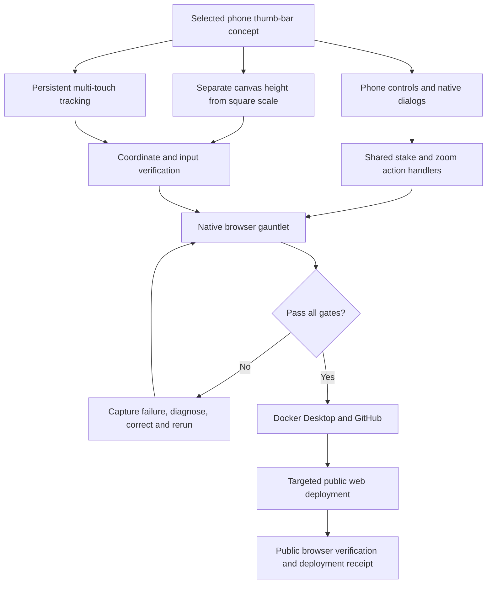

# Maya — mobile thumb bar and pinch zoom

The user selected the **single-row thumb bar** from [Maya - Mobile Gameplay Layout Proposal](Maya%20-%20Mobile%20Gameplay%20Layout%20Proposal.md), explicitly required pinch zoom, and authorised a gauntlet loop followed by Docker Desktop, GitHub and public deployment to https://<your-deployment>.

## Result

Phones now have a single 58 px control row: menu, stake minus, stake/preset selector, stake plus and zoom. Paper balance is in the header. Stake presets, MIN/MAX, funds, navigation, help and wallet remain available in native dialogs. Recent plays retain their five-row limit and chart overlay. Dialogs preserve the chart's size, block new bets behind them, restore focus and support native touch scrolling in short landscape.

In an emulated 390 × 844 CSS-pixel viewport, the actual canvas is **682 px high**, up from **373.0625 px**. The old 120 px panel and separate navigation row are replaced by the 58 px bar. Canvas height is decoupled from square scale on phones: more vertical price bands fit, while the existing horizontal horizon, canonical square geometry, five-second windows, zoom bounds and betting rules remain intact.

Pinch tracking captures both fingers, keeps its state through zoom renders, permits intermediate zoom values and clamps to 0.345–0.9. Lifting either finger leaves the remaining finger unable to place a bet or start a pan. Touch cancellation, window/visibility changes and rotation invalidate pending gestures. A second touch on chrome also cancels a pending board tap. No odds replacement or automatic bet resubmission was introduced.

Phone scope is width below 768 px, plus coarse-pointer landscape under 500 px high and up to 1,000 px wide. Geometry comparisons with the old Docker version passed at tablet 768 × 1024 / 1024 × 768, desktop 1440 × 900, and a short fine-pointer 844 × 390 window. Existing profile/DPR policy is unchanged.

## Implementation graph

Source: `packages/game-ui/src/phone-controls.ts`, `phone.css`, `index.ts`, `geometry.ts`, `layout.ts`; CSS asset-copy registration; two geometry/phone-boundary regressions in `tests/geometry.test.ts`. Existing price, quote-model, acceptance, settlement, persistence and recorder modules were not changed.

## Gauntlet loop and corrections

| Run | Result | Finding / action |
| --- | --- | --- |
| Round 1 | Stopped after 98 checks | A repeated live tap did not increment the expected count. Retained the failure and added pointer/quote feedback capture. |
| Round 2 | Stopped after 80 checks | Native down/up events reached the app, but an existing quote-change safeguard rejected the fourth attempted tap with “That square changed. Try another.” The live harness now distinguishes confirmed rejections from ambiguous outcomes. |
| Round 3 | Stopped after 89 checks | A quote becoming unavailable between touch-down and release could silently discard a phone tap. Added explicit rejection feedback, retaining every acceptance guard and never automatically retrying. |
| Round 4 | **Pass — 104 checks** | Complete corrected phone/input/session journey. |
| Round 5 | **Pass — 127 checks** | Repeated complete journey, plus unchanged desktop/tablet geometry and an actual ETH paper stake. |
| Round 6 | Stopped after 56 checks | The high-level synthesized-scroll CDP call did not scroll the landscape dialog. Replaced that test interaction with a native touch-start/move/end drag. No application change was needed for scrolling. |
| Round 7 | **Pass — 113 checks** | Complete expanded journey, including native landscape scroll and pinch. |
| Docker final, first attempt | Stopped after 45 checks | Landscape pinch did not reach the page in the long-lived automation browser. An independent five-gesture probe recorded zero document pointer events, including over enabled cells. Preserved the failure; did not change game code to bypass it. |
| Docker repeat 1 | **Pass — 112 checks** | Fresh isolated Chromium session, same Docker assets, complete native-input journey. |
| Docker repeat 2 | **Pass — 112 checks** | Repeated the complete journey in that same session; all checks passed again. |
| Docker repeat 3 | **Pass — 112 checks** | Third consecutive complete pass against the final Docker image, without application changes between runs. |
| Public 1 and 2 | Stopped after 45 checks each | The reused cross-origin automation browser again delivered no pointer events to the document. Waiting for a new page ledger and resetting touch emulation did not recover that session. Application code and assets were unchanged. |
| Public fresh 1 | **Pass — 113 checks** | A new isolated browser opened directly at the public origin completed the entire native-touch game journey. |
| Public fresh 2 | **Pass — 112 checks** | Second full public pass in the same browser. |
| Public fresh 3 | **Pass — 112 checks** | Third consecutive public pass; all final interaction gates passed. |

The three successful candidate passes exercise 320 × 568, 360 × 640, 390 × 844, 430 × 932 and rotated 844 × 390 / 932 × 430. Checks cover one-row placement, 44 px or larger thumb-bar controls, header/axis separation, menu bounds, focus and input isolation, pinch spread/inward/cancel, both lift orders, browser zoom remaining 1, all stake presets and bounds, four accepted $5 legs visibly totalling $20, rotation with those positions, wallet focus/link, ten-play consultation, five-row history, a fresh $1,000/ten-play reload, ETH, safe areas and reduced motion.

Every accepted repeated bet is checked for the selected stake and visible aggregate. A changing live quote can legitimately reject a touch. The harness retries only after a specific rejection message and unchanged acceptance/position counts; unexplained input failures still stop the run. The application itself does not retry. Conditional rejection checks make total check counts vary between runs.

Workspace boundaries, typechecking, unit suites and production build passed. **165 tests**: 26 contracts, 15 config, 17 market-data, 25 pricing, 43 engine, 32 game UI, four relay and three recorder tests. Original failures, screenshots and full reports are preserved in the repository under `artifacts/verification/mobile-thumbbar`.

Archived reports: [1](Attachments/Maya%20Mobile%20Thumb%20Bar/round-1.json), [2](Attachments/Maya%20Mobile%20Thumb%20Bar/round-2.json), [3](Attachments/Maya%20Mobile%20Thumb%20Bar/round-3.json), [4](Attachments/Maya%20Mobile%20Thumb%20Bar/round-4.json), [5](Attachments/Maya%20Mobile%20Thumb%20Bar/round-5.json), [6](Attachments/Maya%20Mobile%20Thumb%20Bar/round-6.json), [7](Attachments/Maya%20Mobile%20Thumb%20Bar/round-7.json).

## Deployment and limits

Candidate verification used the production bundle at a separate local preview origin and a separate browser session. The user's session was not reset. Native multi-touch here means Chromium input events supplied through CDP with touch emulation; physical iOS/Android hardware has not been certified.

The first post-Docker failure was isolated to an automation session that stopped delivering input to the document. Restarting that owned browser restored delivery without changing application assets. The exact Chromium/CDP cause was not established; the failed run and empty-event probe remain in the evidence. Subsequent full Docker runs include document-level pointer logging so a recurrence is diagnosable.

Final Docker Desktop verification: three consecutive passes of 112 checks each, healthy web and existing relay, `index-BwVRB5yn.js`, `index-D0zbh0ox.css` and `pricing-worker-ClgO8sKJ.js`. [Docker failure](Attachments/Maya%20Mobile%20Thumb%20Bar/docker-final.json), successful [run 1](Attachments/Maya%20Mobile%20Thumb%20Bar/docker-repeat-1.json), [run 2](Attachments/Maya%20Mobile%20Thumb%20Bar/docker-repeat-2.json), [run 3](Attachments/Maya%20Mobile%20Thumb%20Bar/docker-repeat-3.json).

Application commit **b08a6b84830a107392f73d2053f0e9a7888e5e23** was pushed to private GitHub main and fast-forwarded on the existing host through a verified incremental Git bundle. Only Maya's web service was rebuilt/recreated. The live host's existing `.env` and Compose override hashes were checked unchanged; the relay and recorder retained the same container IDs. The public web container is healthy, still using its existing port and edge-proxy network. The previous public image is retained as `maya-web:before-thumbbar-20260922`.

HTTP release checks passed on both Docker Desktop and https://<your-deployment>: root, health, configuration, BTC/ETH prices and odds table returned 200; SHA-256 of all three JavaScript/CSS/worker assets exactly matched the tested production bundle. The deploy script, build log and HTTP proof are retained in `artifacts/verification/mobile-thumbbar/`. Browser testing of the public origin uses its real feeds and normal paper acceptance handlers.

Public completion: three consecutive full gauntlets passed **113, 112 and 112 checks**, with no uncaught browser exceptions. Public portrait/menu screenshots were visually reviewed. [Public run 1](Attachments/Maya%20Mobile%20Thumb%20Bar/public-fresh-1.json), [run 2](Attachments/Maya%20Mobile%20Thumb%20Bar/public-fresh-2.json), [run 3](Attachments/Maya%20Mobile%20Thumb%20Bar/public-fresh-3.json), [HTTP and asset proof](Attachments/Maya%20Mobile%20Thumb%20Bar/deployment-http.json). Failed [public attempt 1](Attachments/Maya%20Mobile%20Thumb%20Bar/public-1.json) and [attempt 2](Attachments/Maya%20Mobile%20Thumb%20Bar/public-2.json) remain archived.

The QA harness now explicitly waits for a different page-session ledger after navigation before installing probes, then reapplies touch emulation. This hardens page-load sequencing but did not itself recover the previously affected browser; replacing that isolated browser was necessary. The specific missing-input cause remains an automation limitation, not a demonstrated fix to application code. No acceptance or pinch assertion was removed or relaxed. Documentation and harness closeout commits do not change the deployed application assets.

Related: [Maya - Mobile Gameplay Layout Proposal](Maya%20-%20Mobile%20Gameplay%20Layout%20Proposal.md), [Maya - Start Here](Maya%20-%20Start%20Here.md), [Maya - Planning Debug and Results Index](Maya%20-%20Planning%20Debug%20and%20Results%20Index.md), [Maya Runtime - Wallet Controls and Fresh Sessions](Maya%20Runtime%20-%20Wallet%20Controls%20and%20Fresh%20Sessions.md).
