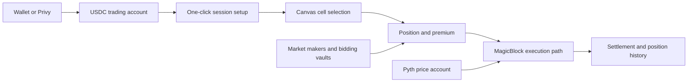

# RUSH — stack, economics, flow and UX

**RUSH is a React/Next.js trading interface backed by Solana/MagicBlock integration code. Its public bundle exposes substantially more protocol detail than its homepage, but current execution and pricing need verification before reuse.**

Scope is `rush.trade` and `app.rush.trade`. Unrelated projects using “Rush,” including `rushgame.vip`, are excluded. Related: [Tap Trading - Deep Research Index](Tap%20Trading%20-%20Deep%20Research%20Index.md).

## Product and observed interface

The [homepage](https://rush.trade/) describes Tap, a separate 1000× product and multiplayer. It claims Solana/MagicBlock/Pyth infrastructure and a dynamic 3–5% fee on profit. These are product statements, not measured throughput or fee receipts. The current app also exposes a **Crush** mode, illustrating why homepage navigation alone is insufficient.

Observed at [the app](https://app.rush.trade/): a live SOL/USD chart, five-second grid spacing, current-time divider, future multiplier cells, $1–$5 desktop stake controls and wallet-gated position history. Many inspected far cells showed 33× while the current-price row showed approximately 1.1×. This is an observed snapshot, not a stable odds schedule or evidence of market depth.

The homepage's ten-second framing must not be equated with every box being ten seconds wide. The current screen shows several future columns; five-second column width, earliest available start, order latency and time to payout are separate measurements.

## Stack evidence

Read-only static inspection covered the Next.js page assets, [layout bundle](https://app.rush.trade/_next/static/chunks/app/layout-4a35bb64c0d0fba6.js) and [main trading bundle](https://app.rush.trade/_next/static/chunks/9893-f292052cafe6b2be.js). Exact fetched URLs include deployment identifiers in the request manifest.

| Layer | Evidence |
|---|---|
| Frontend/build/hosting | React and Next App Router assets; Vercel HTTP response header |
| Rendering | Canvas 2D, device-pixel-ratio sizing and animation-frame chart drawing |
| Authentication | Privy integration and Solana wallet support |
| Trade authorization | Session wallet/token structures and one-click setup in the actual tutorial |
| Protocol | Embedded Anchor interface, Solana token accounts/PDAs, MagicBlock delegation, Pyth price accounts |

No Three.js renderer was established. The Vercel header identifies the served frontend, not necessarily the matching engine or database. A Solana/Anchor interface strongly suggests an Anchor program, but client artifacts alone do not reveal every production backend process.

## What the protocol interface reveals

The public bundle contains an Anchor IDL named `magicblock_tap`, version `0.1.0`, address `HDpQBXfTwAcH2S964H9tv6LP9FaAKPjBt4rK4EVNoUkD`. Extracted names, arguments and structures are saved in [interface facts](Attachments/Tap%20Trading%20Research/rush-interface-facts.json).

| Interface group | What it suggests |
|---|---|
| Position creation, bidding, auction end, settlement | Quotes/trades can be backed by competing market-maker commitments, not just client-side win calculation |
| Bidding-vault deposits, shares and withdrawals | Capital can be pooled for market-making; economic exposure is distinct from player balances |
| User-account delegation and undelegation | A high-speed execution context can operate on delegated state |
| Session token with signer, target and expiry | Repeated trades can avoid repeated wallet prompts after setup |
| Fee, feed and market-maker configuration | Operator/admin controls exist in the interface; present values and authority constraints need chain/source inspection |

Position records include price bounds, expiry, premium, market-maker index and payout. Settlement events include winner, price, payout and fee. These data structures support an economic ledger and post-trade history, but they do not expose the full condition evaluated inside settlement.

## Reconstructed execution flow

**Inference from UI and interface**, not a traced funded transaction. Public code also uses application API routes for account setup, positions and parameters. Therefore the product is not accurately described as “only a static frontend talking directly to a public blockchain.”

MagicBlock's [oracle documentation](https://docs.magicblock.gg/pages/tools/oracle/introduction) explains its general Pyth Lazer account-update architecture at asset-dependent 50–200 ms intervals. This establishes infrastructure capability, not RUSH's actual production feed frequency or finality. The homepage's speed promises were not independently benchmarked.

## Pricing: significant unresolved inconsistency

The trading bundle contains a range-pricing implementation with these observed features:

1. It obtains model parameters from `/api/v1/pricing/parameters`, with caching and defaults.
2. It estimates probability using a normal-CDF difference for a future log-price interval, with volatility and jump terms.
3. Its business defaults include `houseEdge = 0.75`, multiplier bounds and grid percentage.
4. It changes the current-price cell's multiplier using a random value, with different ranges during New York market hours.
5. The clicked-cell path adds one to the model's multiplier, creating a gross/net interpretation issue.

**Do not describe this as a proven 75% player loss rate.** A client default is not a live fee disclosure, the displayed multiplier includes a conversion, and server execution can differ. The public parameter endpoint returned HTTP 502. The observed 33× far cells are consistent with a 32-plus-one cap, but that does not prove all live quotes followed the fallback branch.

A terminal-price probability and a touch-during-window probability are different mathematical events. The homepage describes entry into a cell, while the exposed formula is terminal-range based. The actual program's condition was not verified, so this is a concrete question to resolve, not proof that the service settles incorrectly.

For Maya, these are reasons to define the payoff first and calibrate odds against the same event used by settlement. A working-looking grid is insufficient evidence of a coherent financial model.

## Fees, capital and commercial economics

The homepage's profit-fee claim is distinct from market-maker pricing. The IDL includes a global basis-point fee parameter, a fee collector and fee updates. We did not read the live global state or reconcile fees against receipts, so the actual current fee schedule remains unverified.

**Economic inference:** a bidding vault can earn or lose money as counterparty; a protocol fee can earn revenue independently of that trading P&L. Neither total vault deposits nor gross notional volume equals protocol revenue. The separate leveraged product makes aggregate volume especially easy to misinterpret.

If a winning gross multiplier is `M` and fee `f` applies only to profit, a hypothetical successful $S trade returns `S + S(M−1)(1−f)`. This is our comparison formula, not a verified RUSH accounting rule.

Unknown: active market-maker count, vault solvency/reserves, live fee values, pricing overrides, actual hedging, operator profit, deposit-to-withdrawal timing and independently verified usage.

## User flow and UX

The actual five-step tutorial explains wallet connection, USDC funding, one-click enablement, stake selection and tapping a chart cell. It teaches authorization as a separate setup step, a useful explanation for users wondering why later taps need no popup.

Desktop uses a chart-plus-sidebar arrangement: price/grid on the left, stake sizing above position history on the right. High multipliers and prospective monetary gains compete for attention. Green dominates both the live line and promising cells, reducing contrast between current state and opportunities.

The 390 × 844 layout is materially different: nearly full-screen chart, floating menu/history controls, a stake button near the bottom and a persistent mode bar. **Observed interaction:** tapping the $1 stake button changed it directly to $2; it did not open a chooser. This mirrors the compact cycling approach in our reference. No bet was placed.

UX strengths: chart visible before login, thumb-reachable stake control, persistent mode navigation and explicit session tutorial. Weaknesses observed/inferred: tiny mobile cell text, dense equal-sized high-odds opportunities, implicit stake cycling, and several product names competing for navigation space. MIN/MAX shortcuts and discrete zoom levels were not verified in the unauthenticated screens.

## Verification limits

A read-only `getAccountInfo` call for the embedded IDL address against the app-referenced MagicBlock endpoint returned `null`. This does **not** prove the program is absent on Solana: an ephemeral RPC and the base chain need not expose identical account views, and a bundled interface may be stale. It means deployment equivalence was not established.

No publicly attributable full RUSH source repository or audit report was verified. No authentication barrier was bypassed. The report's strongest evidence is the public app, tutorial, client code and embedded interface—not a funded execution trace.

## Takeaway for Maya

Learn from the mobile control placement and one-click authorization story. Treat the exposed protocol as a useful architectural example. Do not import its probability formula, fallback values or marketing speed guarantees into the game specification without resolving the payoff, multiplier and deployment questions first.
