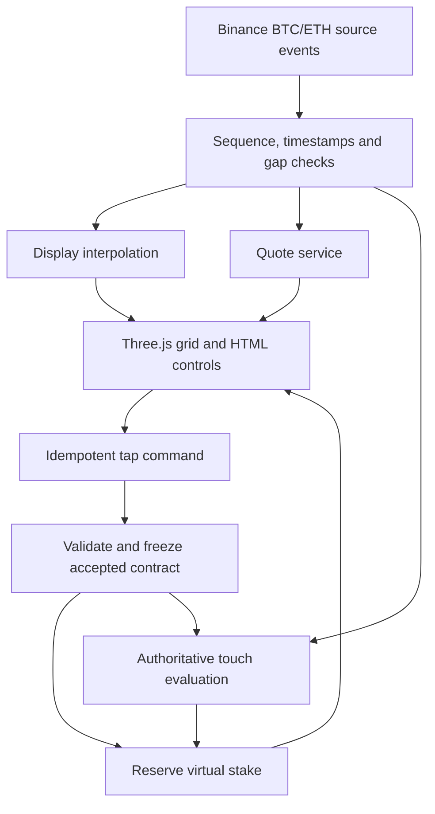

# Economics and implications for the Maya build

**Specify the financial event before reproducing the interface. Then implement the display, quotation and settlement as separate systems.** This note contains our derivations and design recommendations, not claims about undisclosed vendor internals.

Product evidence: [Euphoria - Stack Economics Flow and UX](Euphoria%20-%20Stack%20Economics%20Flow%20and%20UX.md), [RUSH - Stack Economics Flow and UX](RUSH%20-%20Stack%20Economics%20Flow%20and%20UX.md), [Lynx - Stack Economics Flow and UX](Lynx%20-%20Stack%20Economics%20Flow%20and%20UX.md). Existing authorized build scope: [Three.js Trading Game - Fidelity Build Plan](Three.js%20Trading%20Game%20-%20Fidelity%20Build%20Plan.md).

**Selected direction:** the user chose Euphoria for appearance, interaction and behavior. [Euphoria - Product Reference and Fidelity Requirements](Euphoria%20-%20Product%20Reference%20and%20Fidelity%20Requirements.md) governs the experience; the other products' economics remain comparative evidence rather than default features to add.

**Controlling update:** [V1 - Locked Product Scope](V1%20-%20Locked%20Product%20Scope.md) selects Lynx public prices and local indicative odds for BTC/USD and ETH/USD, with paper funds only. Preserve recovered Euphoria controls; exact numeric Euphoria odds are outside v1.

**Provider history:** Wintermute and Binance are deferred for v1. The older Binance diagram below remains an architecture example; the active plan is [Euphoria - Paper Trading Implementation Plan](Euphoria%20-%20Paper%20Trading%20Implementation%20Plan.md).

## Three contracts that can look identical

| Event | Success rule | What must be observed |
|---|---|---|
| Touch window | At least one qualifying price enters `[L,U]` during `[t0,t1]` | All authoritative samples/windows in that interval |
| Expiry range | Price is inside `[L,U]` at `t1` | Defined expiry observation |
| Stay inside | Price remains within `[L,U]` throughout the interval | Complete observation coverage plus gap rules |

Our reference strongly indicates the first. Euphoria's current documentation explicitly states the first. Lynx Solo's API documents the first. RUSH's marketing resembles the first, but the inspected client probability calculation resembles the second; deployed settlement was not verified.

For an otherwise identical interval, a price can touch a band and subsequently leave it, producing a touch win and an expiry loss. That difference changes the correct payout. A visually smooth line can also cross a band between actual source observations. Define whether settlement uses sampled ticks, interpolated crossing or oracle window high/low; none is automatically interchangeable.

## Payout arithmetic

Let `S` be stake, `M` the **gross** multiplier including the returned stake, and `p` the true hit probability.

`win profit = S(M − 1)`

`loss = −S`

`expected player profit = S(pM − 1)`

For fair actuarial pricing, `M = 1/p`, ignoring costs and risk compensation. With a model margin `h`, a common quote is `(1−h)/p`. If the model probability is correct, expected player profit is approximately `−Sh`; rounding and acceptance rules alter the exact result.

Example: `p=0.40`, `S=$5`, `h=0.10` gives `M=2.25`. A win returns $11.25 gross, or $6.25 profit. A loss costs $5. Across many independent repeats with that fixed true probability, expected profit is `0.4×6.25 − 0.6×5 = −$0.50` per wager. This illustrates Lynx's published margin form; it is not an observed player return or a claim that our chosen box has 40% probability.

For an explicit fee `f` on winning profit, gross cash returned would be `S + S(M−1)(1−f)`. A platform may also price a margin into `M`. Therefore “3% fee” and “3% expected loss” are different statements.

## Counterparty and revenue model

| Model | Who carries payout risk? | Revenue interpretation |
|---|---|---|
| Competitive market-maker quotes | Accepted counterparty/collateral arrangement | MM spread/P&L and platform fees/revenue share are distinct |
| House-priced solo play | House or backing pool | Stakes minus payouts is gross gaming P&L, not net profit |
| PvP pot with fee | Entrants fund a bounded pot, subject to rules/subsidies | Entry fees/rake; bot funding and incentives affect operator net income |

Euphoria's current fee disclosure does not reveal MM/platform revenue sharing. RUSH's bidding-vault interface suggests a capital-bearing counterparty but its current values were not verified. Lynx's live solo config and PvP rooms give explicit model-margin/fee fields. We have not audited any operator's profitability.

A plausible operator accounting identity is `explicit fees + retained counterparty P&L − subsidies − referral payouts − data/chain costs − operating costs`. Do not substitute headline notional volume for any of these terms.

## Correlation and liability

Two vertically adjacent cells can both win in the same window. Multiple bets across time also share the same path. As a result:

- The grid is not a roulette board with exactly one winning cell.
- A portfolio of bets cannot be priced or risk-limited by treating each as independent.
- Exposure caps should cover individual cells, time columns, assets, users and shared price scenarios.
- A maximum stake can depend on balance, account limits and available quote capacity.
- Changing zoom must not change an accepted position's band, window, stake or odds.

The clip's adjacent wins and Euphoria's exposed exposure categories reinforce this inference. None of the vendor pages gives enough information to reconstruct its complete joint-risk model.

## Recommended implementation boundaries

The current plan remains **virtual funds with real Binance BTC/ETH prices**. This diagram does not authorize real-money execution or imply Binance offers these contracts.

The display can animate at a chosen frame rate while settlement processes all source events. Use an explicit quote ID, expiry, requested stake and acceptable multiplier deviation. Acceptance freezes market, bounds, timestamps, odds and data-source identity. A repeated request must not debit twice. A timeout is an unknown result until reconciliation, not permission to blindly retry.

Store balance movements as entries: reserve, rejection release, settlement credit and adjustment/void. Keep visual state optimistic only where the user can see that acceptance is pending. A win animation should follow authoritative confirmation.

## UI rules worth carrying forward

1. **Reference stake picker:** use Euphoria's menu and tier filter, checking balance/exposure at placement. Preserve the distinction between maximum placement size and total per-square stake; do not pretend to have live counterparty depth.
2. **Reference zoom:** use the recovered continuous bounds and wheel factors, preserving placed contracts and pointer mapping. If a future feature changes actual band widths, issue different offers and distinguish that from visual zoom.
3. **Visible monetary meaning:** label gross return separately from profit. In PvP, label credits and prize money separately.
4. **Honest state:** show pending, accepted, rejected, settling, won/lost and voided distinctly, including stale-feed status.
5. **Desktop/mobile layouts:** keep the market visible before login, use thumb-reachable controls, and retain legible odds rather than packing every desktop row onto a phone.

These recommendations now follow the user's exact-control request and the recovered Euphoria settings. Rapid-fire drag betting is not part of the selected scope.

## Build versus integrate

For a faithful virtual recreation, own the frontend and ledger; use the supplied recording for replay tests. Euphoria is the strongest visual/rule reference.

For an eventual existing financial backend, Lynx's published alpha client is the most concrete lead found. Before selection, verify live capability compatibility, authoritative pricing, failure behavior, audited contracts, commercial rebranding terms and actual redemption flow. An internal alpha package is not a turnkey production commitment.

For a Solana-native implementation, RUSH illustrates sessions, account delegation and market-maker bidding, but its client/marketing inconsistencies prevent treating it as a specification. None of these findings justifies promising a 100% identical financial product from a copied chart alone.
