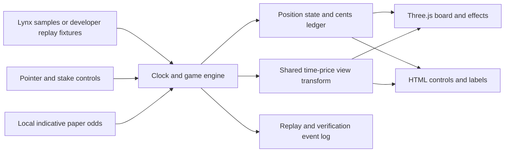

# Three.js trading game — fidelity build plan

**Controlling update:** [V1 - Locked Product Scope](V1%20-%20Locked%20Product%20Scope.md) and [Euphoria - Paper Trading Implementation Plan](Euphoria%20-%20Paper%20Trading%20Implementation%20Plan.md) lock Lynx public prices and local indicative odds for BTC/USD and ETH/USD. Paper money only, with recovered Euphoria controls and visual/interaction fidelity.

**Playable-demo scope:** open directly to the board with free paper funds. Every visitor can choose either pair, adjust zoom/stake within shared limits and tap bets. Price determines win/loss; locked odds determine payout. No login, account tiers, confirmation flow or slippage settings. Replay and test fixtures are developer tools, not a player mode-selection screen.

**Maya sales flow:** the user named the product **Maya**. Allow ten accepted paper bets per page load, then show the consultation modal for white-label purchase, customisation, launch and source handover. New placements stop until refresh; existing bets keep settling. Refresh deliberately grants ten more, with no persistent visitor limit. Use dummy `https://example.com` as the configurable booking URL. See [V1 - White-label Demo and Consultation Flow](V1%20-%20White-label%20Demo%20and%20Consultation%20Flow.md) for copy and exact rules; this product-specific sales overlay is an intentional addition to the reference experience.

**Monorepo/adaptive update:** [Maya - Development Graph](Maya%20-%20Development%20Graph.md) and [Maya - Monorepo and Adaptive Layouts](Maya%20-%20Monorepo%20and%20Adaptive%20Layouts.md) govern the implementation package layout and distinctly optimized desktop, tablet and mobile compositions. Earlier module-path sketches below describe responsibilities; the new canonical workspace map controls their actual locations. One scene, engine, persisted ledger and page allowance survive profile transitions. Node and graph QA each have three explicit review rounds.

**Prior provider history:** Binance and Wintermute plans are superseded for v1. The earlier version of this document is preserved in [the plan archive](Attachments/Tap%20Trading%20Research/Plan%20History/Three.js%20Plan%20-%20before%20Lynx%20v1%20lock.md). No automatic fallback or external firm-quote integration is selected.

**Build a playable Three.js game that looks, feels and works like Euphoria: the burgundy price-time grid, moving price trace, live multipliers, neon position cards, direct tapping, quote acceptance, balance behavior and settlement feedback.**

**Accepted direction, 20 September 2026:** Euphoria is the primary product reference, not one of three equal design options. The supplied clip remains the visual calibration fixture. See [Euphoria - Product Reference and Fidelity Requirements](Euphoria%20-%20Product%20Reference%20and%20Fidelity%20Requirements.md) for the binding experience requirements and [Euphoria - Stack Economics Flow and UX](Euphoria%20-%20Stack%20Economics%20Flow%20and%20UX.md) for the verified evidence. RUSH and Lynx inform engineering research without defining this product's experience.

The target is complete coverage of the visible behavior, with frame-by-frame visual matching at the reference resolution. Literal 100% equivalence to the original product cannot be established from a 54-second recording: its font files, source price ticks, quote engine, and backend rules are unavailable. Those gaps are listed as explicit implementation choices rather than silently guessed.

**Deliverables:** a reference replay, an interactive game using virtual funds, and a fidelity report comparing the implementation with the clip. This document is a plan; no game has been implemented yet.

Source of observed requirements: [Video Analysis - Price-Time Prediction Grid](Video%20Analysis%20-%20Price-Time%20Prediction%20Grid.md).

**Current direction, 20 September 2026:** Lynx-only public inputs for BTC/USD and ETH/USD, locally calculated paper odds and virtual USD. Euphoria remains the reference for the interface, controls and trading lifecycle. See [V1 - Locked Product Scope](V1%20-%20Locked%20Product%20Scope.md).


## 1. Product boundary and fidelity contract

The initial application is a single full-screen game at **1642 × 904** as the primary comparison viewport. Three.js renders the board, chart, cards, and effects; a synchronized HTML overlay supplies crisp controls, labels, and accessible interaction. The flat appearance is intentional even though the scene uses a 3D rendering library.

Three modes share the same renderer and game state:

| Mode | Purpose | Behavior |
|---|---|---|
| **Reference replay** | Verify similarity to the supplied video. | A reconstructed price path, camera motion, quote snapshots, input events, rejections, and settlement events reproduce the 53.888-second sequence. Replay starts at $68.82 and finishes at $28.67. |
| **Live paper play** | Inspect BTC/USD and ETH/USD prices. | Lynx public samples drive the chart; a local Lynx-derived model quotes paper positions. No provider orders or credentials. |
| **Deterministic test fixtures** | Offline settlement and interaction verification. | Seeded prices and explicit fixture quotes exercise rules; this is a developer mode and does not claim Euphoria-identical live odds. |

Reference replay is a visual fixture, not proof that a replacement pricing engine matches the original. In interactive mode, wins must come from settlement rules rather than preselected winning cards.

The first version opens directly to the chart with a two-market USD selector and a subtle paper indicator. A development-only replay/scrub panel sits outside the comparison view. Unseen account systems are outside the fidelity claim. Lynx supplies public inputs; local pricing and settlement are paper-only.

**Working project location:** `<repo>`. Keep application code outside the Obsidian vault; keep the specification and reference evidence in Maya.

## 2. Screen specification

### Layout measurements

These are initial measurements from extracted frames and must be calibrated against the source during implementation.

| Feature | Starting specification at 1642 × 904 |
|---|---|
| Board | Full viewport; no external margin, title bar, sidebar, or card container. |
| Current-price tip | Usually near x = 475 px, approximately 29% of width; allow reference camera movement. |
| Grid spacing | Approximately 91–92 px per cell in both directions in the initial view. |
| Cell meaning | 5 seconds horizontally; $0.50 vertically, based on visible axes. |
| Axis labels | Time every 15 seconds at bottom; price every $0.50 at right. |
| Asset pill | Top-left, about x = 12 px / y = 18 px, ~165 × 43 px. |
| Wallet pill | Bottom-left, about 12 px from left and 44 px above bottom; ~120 × 44 px. |
| Stake pill | Bottom-right, around x = 1533 px / y = 815 px; width varies with digits. |
| Toast | Around x = 504 px / y = 12 px, ~355 × 54 px; centered relative to the reference's content region, not assumed to be the whole viewport center. |
| Selected card | Nearly the full grid cell, ~88–90 px square; rounded corners and a narrow pale outline. |

Use a single view transform for the chart, grid, card geometry, labels, and pointer picking. It is a bug if any of those drift apart while panning, resizing, or following price.

### Euphoria zoom and stake extremes

Preserve Euphoria's zoom geometry: current public code uses continuous pinch and wheel scaling, bounded at 0.345–0.9 with a fresh route default of 0.6; wheel factors are 1.1 inward and 0.9 outward. Cell size is canvas height / 6 × zoom. The previously proposed five-level preset list is withdrawn. Preserve reset semantics and verify its visual affordance against a current reference. See [Euphoria - Paper Trading Implementation Plan](Euphoria%20-%20Paper%20Trading%20Implementation%20Plan.md) for source provenance.

Zoom changes the view transform. It must never change an accepted position's price band, time window, stake, or multiplier. Keep labels and picking synchronized and anchor zoom consistently around the current-price tip. If a later design changes offered cell granularity at a zoom level, those become new offers with new quotes; existing positions retain their original rectangles.

Give every visitor the same menu: **$0.10, $0.50, $1, $5, $10**, default **$1**, and a **$50 total stake cap per square**. These demo implementation defaults use Euphoria's recovered standard limits. No profile, VIP gate or inaccessible $25/$50 choices. Raising/lowering moves through the allowed menu and stops at its endpoints; insufficient balance is checked on placement. Start with $1,000 virtual USD and allow a free $1,000 refill without changing existing bets. These virtual-fund amounts are our demo defaults, not recovered Euphoria values.

### Color, type, and surface treatment

Start from the sampled plum background values **#361727 / #2B1220** and control interior **#1A0A13**. Measure representative grid, text, active-card, and glow colors from their own screenshot regions before finalizing tokens.

Reproduce the muted magenta grid, brighter intersection dots, faint historical region, thin pink price history, nearly white recent segment, and white endpoint. Active cards use a luminous yellow-green center, pale edge, dark stake text, and a smaller muted multiplier.

Identify the closest font by comparing actual glyph shapes, width, weight, and line height against crops. Do not assume that a generic monospace font matches the narrow chart typography. If the original font cannot be identified, record the substitution in the fidelity report.

Visual constants belong in one `referenceTheme` configuration. Keep animation durations, glow falloff, card radius, toast position, and typographic metrics adjustable without editing game logic.

### Required visible states

| State | Required appearance |
|---|---|
| Offered square | Quiet multiplier on a transparent/dim grid cell. |
| Hover / focus | Subtle border emphasis; keyboard focus may use the same visual treatment. |
| Submitted square | Immediate card appearance, with a brief placement transition. |
| Accepted position | Stable stake and confirmed multiplier; card moves with world coordinates. |
| Rejected square | Orange/red warning treatment, “Try another square.” toast, then removal. |
| Insufficient funds | “Insufficient balance.” toast; no lasting stake debit or active card. |
| Missed position | Muted translucent card, short fade, then removal. |
| Winning position | Yellow-green energy burst, sparks, floating payout, precise toast, and wallet credit. |

“Try another square.” must be reproduced in reference replay at the observed times. Its interactive-mode meaning must be explicitly defined because the source does not explain it.

## 3. Game rules and state

### Coordinate and time model

Each cell has a stable identity independent of camera position:

```text
cellId = marketId + timeBucketIndex + priceBandIndex
window = [startTime, endTime)       // 5 seconds
band   = [lowPrice, highPrice]     // inclusive; BTC $10 or ETH $0.50
```

Use a monotonic simulation clock with a separate display-clock origin. A resize or camera shift must not change a cell's actual time or price band. Store prices in a fixed-point unit with enough precision for the feed; store balances and stakes as integer cents.

### Placement transaction

1. Resolve the pointer to a cell using the current inverse view transform.
2. Validate cell availability, cutoff, quote version/age, duplicate policy, and available balance.
3. Atomically accept the exact valid displayed multiplier, debit once and create the position with a unique request ID.
4. Freeze market, time window, price band, stake and multiplier for the position.
5. If validation fails, show feedback without debiting or opening a bet.

All steps are local and require one tap; no artificial delay, confirmation dialog or order form. Retain atomic transaction boundaries internally. Reference replay can reproduce its historical provisional cards and rolling balance digits separately.

**Interactive paper defaults:** independent placements may share a cell up to the shared $50 cap; request retries remain idempotent. Enforce the compatible public-config lead time (observed three seconds) and five-second window alignment. This is a v1 parameter, not a recovered Euphoria timing cutoff.

Record the displayed quote revision and accepted multiplier. Accept a still-valid quote exactly, or reject an expired/unavailable quote without debit; do not silently substitute worse odds. No slippage setting is exposed. After acceptance the multiplier never changes. Tune visual replay independently of these demo rules.

The historical replay preserves its observed **1 → 5 → 10 → 50 → 100 → 200 → 500 → 1** stake cycle. Playable demo mode uses the shared five-choice menu above. Changing stake affects only future placements; existing cards retain their original stake.

### Settlement rule

Euphoria's public guide now confirms the broad mechanic: **a position wins once when the price touches its price band during its five-second window**. It need not remain or finish inside. If its window ends without a hit, it expires with no credit. Exact timestamp, boundary and jump semantics remain implementation choices pending deeper contract evidence; see [Euphoria - Stack Economics Flow and UX](Euphoria%20-%20Stack%20Economics%20Flow%20and%20UX.md).

For deterministic fixtures, use explicit timestamped samples and the same settlement predicate as live paper mode. Historical replay may preserve observed outcomes separately; interpolation is a display operation, not settlement evidence.

For live v1 data, use Lynx source samples and timestamps. Process all recovered samples for settlement independently of render rate; apply the freshness, recovery and refund rules in [V1 - Locked Product Scope](V1%20-%20Locked%20Product%20Scope.md). Do not synthesize a touch between samples.

Use half-open time windows `[start, end)` and inclusive price bands `[lower, upper]`. Process source timestamps chronologically and define tie ordering for quote updates, taps, ticks and expiry. Every position has one idempotent terminal outcome.

```text
offered → pending → accepted → won → removed
                  ↘ rejected → removed
                    accepted → expired → removed
```

A fixed accepted multiplier determines the gross credit:

```text
payoutCents = round(stakeCents × multiplierHundredths / 100)
```

The multiplier is represented as integer hundredths for purchased cards. The reference's known examples are exact: **500 × 251 / 100 = 1255 cents**, and **500 × 246 / 100 = 1230 cents**.

### Price and quote engines

**Replay:** reconstruct the time series and view transform from the video, preserving visible turns, plateaus, and sharp steps. Digitize the bright tip and top-left quote across the full recording; recover pre-existing history from the initial frame. Capture relevant quoted values and accepted card multipliers separately. Do not interpolate a 2 fps extraction and call that the original tick stream. Use the original 30 fps footage for final calibration.

**Live mode:** implement a read-only Lynx public-data adapter for BTC/USD and ETH/USD. Normalize pair/feed IDs, source timestamps and exact prices; share virtual-USD balances across markets. Keep accepted positions attached to their market. Preserve five-second windows, BTC $10 bands and ETH $0.50 bands; validate the local pricing model against those dimensions.

**Practice mode:** use a reproducible seeded stochastic price model whose movement scale resembles the clip. Keep both sources behind `PriceFeed`; never silently substitute generated prices during a live-feed outage.

**V1 odds decision:** use local indicative Lynx-derived multipliers. The user has accepted this no-registration route; exact numeric Euphoria parity is no longer required for v1. Preserve quote/request/acceptance states and fixed accepted odds, and record model/config provenance.

## 4. Three.js architecture

Use **TypeScript + Vite + Three.js**, with a small state store and plain HTML/CSS controls. A UI framework is unnecessary for this single scene. Pin versions and the package lock when implementation begins.

An orthographic camera keeps this flat chart free of perspective distortion. Three.js documents this camera as suitable for 2D scenes and UI because apparent size is independent of distance. [OrthographicCamera documentation](https://threejs.org/docs/pages/OrthographicCamera.html).



### Rendering ownership

| Component | Implementation decision |
|---|---|
| Background and grid | Full-screen shader or batched planes/lines, with procedural fading and node dots; avoid a separate heavy object for every cell. |
| Price path | A bounded point buffer and `Line2`/`LineMaterial`, with age-based vertex colors and a separate endpoint sprite. Keep interpolation from creating visible price overshoot. |
| Cards | Instanced planes with a rounded-rectangle shader for fill, border, rejection tint, and local glow. Each instance has a stable position ID. |
| Quote and card text | Start with a pooled DOM text overlay projected from the same view transform; update only changed strings. If profiling warrants it, replace board labels with a glyph atlas without altering layout. |
| Controls and toasts | HTML/CSS for precise type, icons, rounded translucent pills, rolling digits, click targets, and accessibility. |
| Win effects | Pooled Three.js particles and an animated irregular ring; additive local glow, plus projected payout text. |

`Line2` supports controllable line width and is an explicit addon; use its WebGL variant with `WebGLRenderer`. [Line2 documentation](https://threejs.org/docs/pages/Line2.html).

Instancing is intended to reduce draw calls for repeated geometry; update instance attributes in batches and retain a mapping between instance IDs and positions. [InstancedMesh documentation](https://threejs.org/docs/pages/InstancedMesh.html).

If a text atlas is required, `CanvasTexture` provides the canvas-backed texture primitive. Build/rebuild the atlas deliberately rather than creating one new texture per changing number. [CanvasTexture documentation](https://threejs.org/docs/pages/CanvasTexture.html).

Use explicit layer order for grid → trace → cards → effects → controls. Favor local glow sprites/shaders first; introduce a bloom pass only if screenshot comparison shows that the effect cannot be matched otherwise. Whole-screen bloom can wash out the reference's dark tones and small text.

### Proposed modules

```text
src/
  core/       Clock, GameEngine, PositionStore, WalletLedger, DemoAllowance, event types
  feeds/      LynxPublicFeed, ReplayFeed, SeededPriceFeed, PriceFeed interface
  quotes/     LynxPreviewQuotes, ReplayQuotes, QuoteProvider interface
  scene/      BoardScene, GridLayer, PriceTrace, PositionLayer, WinEffects
  view/       ViewTransform, CameraController, PointerMapper
  ui/         AssetPill, WalletPill, StakeSelector, Toasts, LabelPool, ConsultationModal
  config/     Maya branding, consultationUrl, demoBetLimit
  reference/  theme, replay manifest, price samples, quote samples, events
tests/
  settlement, ledger, demo allowance/refresh, input mapping, replay flow, visual checkpoints
```

The game engine must run without a renderer. Rendering reads snapshots and events; effects must never directly change balances or settle positions.

`DemoAllowance` is document-lifetime memory, independent of the persisted ledger. Atomically gate new acceptances at ten, then emit the consultation UI event; reject an eleventh without debit. Pair changes/rerenders/refills do not reset it. Restored old positions consume no fresh allowance. The modal never pauses feed ingestion, clock or settlement. Only prospect-facing live demo mode uses this allowance; historical developer replay retains its original thirteen accepted placements.

## 5. Motion and camera matching

Use one animation clock for all effects. Record effect start times, so seeking replay or capturing a screenshot at a fixed time reproduces the same state. Seed all decorative particle randomness in replay mode.

| Motion | Matching approach |
|---|---|
| Horizontal scroll | Convert elapsed market time to world x; move the camera so the tip remains near the reference anchor. |
| Vertical follow | Reconstruct camera movement in replay. In free play, use a damped dead-zone follow so the price remains visible without continuous jitter. |
| Placement | Match first visibility, scale overshoot, fill, and final card size from a dense event crop. |
| Expiry | Match dimming onset and removal; keep misses visually quiet. |
| Win | Match ring size, irregular contour, spark directions, glow, payout rise, and fade against the 46.5 s and 49.5 s evidence. |
| Digits and toasts | Match amount roll transitions, toast stacking, and duration; retain cents precision in wallet and toast text. |

Do not use guessed millisecond durations as final requirements. Measure onset and disappearance from the original frames, then store the calibrated values in the theme/replay data. Audio is unresolved: no verified speech was recovered, and specific click/win sounds must not be invented as if observed.

## 6. Build sequence

### Prerequisite — Read-only feed/model proof

Verify both public USD feeds and representative five-second cells with BTC $10 / ETH $0.50 bands. Establish supported model inputs, quote validity and stale-data behavior before connecting the renderer. This is implementation verification, not a player onboarding step. The live playable loop is the delivery priority; replay remains a developer fidelity fixture.

### Phase 1 — Reference pack and frozen frame

Create the Vite/TypeScript shell, load Three.js, and implement the shared coordinate transform. Build the empty board and fixed controls at 1642 × 904. Measure the font, colors, spacing, and price-line shape against the first frame.

**Deliverable:** a still view plus a screenshot overlay showing the remaining mismatch. **Exit criterion:** primary control bounds, grid spacing, and axis positions are within an initial **2 px** target; any unavoidable font substitution is documented.

### Phase 2 — Live chart and playable paper bets

Implement cell picking, the shared stake menu and caps, one-tap acceptance, fixed-point paper balance/refill, and sampled touch-window settlement. Connect both Lynx USD markets and the local indicative model. Reproduce warning messages and no-credit expiry. Verify pair switching, stale-feed handling, gap refunds and event deduplication. Price movement determines wins; the accepted multiplier determines gross payout. No random win/loss roll, signup or account tier.

**Deliverable:** any visitor can choose a pair, zoom, change stake, tap and receive a price-driven outcome. **Exit criterion:** both markets work, all shared limits hold, multipliers stay fixed, and wins/misses/refills reconcile without duplicate or random settlement.

Add the Maya consultation flow in this phase: tenth acceptance opens the modal once; further placement is blocked until refresh; each refresh permits ten more without disturbing existing bets. Verify the placeholder CTA opens `https://example.com` only on user click. Sales/configuration literature is outside the gameplay surface.

### Phase 3 — Deterministic reference replay

Reconstruct the clip's price path, visible quote snapshots, camera transforms, and event timing. Add developer-only replay seeking. Use the full original frame rate to refine important transitions.

**Deliverable:** the entire 53.888-second reference sequence can be replayed and captured at exact elapsed times. **Exit criterion:** selected visual checkpoints align; the recorded positions reconcile to **13 × $5**, the credits are **$12.55 and $12.30**, and the replay ends at **$28.67**. Interactive outcomes continue to follow the live rules independently of this fixture.

### Phase 4 — Visual effects and interaction polish

Implement card glow, warning gradients, fades, animated digits, stacked toasts, particles, and payout text. Match both wins individually. Add keyboard cell navigation and touch input without altering the desktop comparison scene.

**Deliverable:** matched success, failure, and near-hit states. **Exit criterion:** event animation starts within an initial target of **two source frames (~67 ms)**, and the chart stays smooth while multiple effects run.

### Phase 5 — Fidelity and performance review

Capture the final application against the reference, test resize behavior, profile a longer interactive session, and record remaining mismatches. Fix visually important deviations in order: composition, chart/camera, typography, cards, then effects.

**Deliverable:** working local build, reproducible replay, screenshots/diffs, and a short fidelity report. **Exit criterion:** every demonstrated state has been reproduced, no ledger or settlement failures remain, and known limitations are stated rather than concealed.

## 7. Verification that matters

### Visual checkpoints

Compare **0, 3.5, 8.5, 16.5, 26.5, 37, 43.5, 46.5, 49.5, and 53.8 seconds**. These cover the empty board, placement, position clusters, rejection, cleared board, exhausted balance, stake cycling, both wins, and final state.

Use exact viewport dimensions, device scale, fonts, and replay seed. Inspect a 50% overlay and per-region image differences. Do not accept a flattering global similarity score dominated by the large dark background. Evaluate control geometry, line shape, odds typography, selected cards, and particles separately. Numeric labels and toast text require exact string checks.

Pixel comparisons against a compressed video require tolerance. Define tolerances after measuring video compression noise; do not promise byte-for-byte image equality. The initial 2 px geometry / 67 ms timing thresholds are project targets, not results already achieved.

### Functional checks

1. **Settlement:** qualifying source sample wins; a visual crossing between samples cannot win; price boundaries are inclusive and time windows half-open. Test misses before/after the window, adjacent bands and missing-data refunds. Each position settles once, without RNG.
2. **Wallet:** rapid taps cannot overspend; rejection charges nothing; duplicate events cannot debit or credit twice; gross payouts round in cents; expiry adds no credit; refill leaves existing bets intact.
3. **Interaction and consultation:** any visitor can use both pairs and every allowed stake without signup. Verify correct picking after zoom/resize, the 9→10 limit, modal dismissal, dummy CTA navigation and repeated refresh allowances. Zoom, market changes, refills and modal visibility cannot alter accepted bets; rejected taps/retries cannot consume extra allowance.
4. **Replay:** all key events and balances match the recorded fixture; changing interactive placements changes outcomes under the same price seed.
5. **Lifecycle/performance:** a ten-minute run has bounded histories, stable resource counts, no console errors, and no accumulating expired cards, labels, or particles.

Target 60 fps on the actual test desktop; record the hardware and frame-time distribution before claiming it is achieved. Cap device pixel ratio for normal play if needed while retaining a fixed comparison configuration. Pause/resume must preserve game-time semantics, and event catch-up must not skip settlement when rendering stalls.

Mobile layout is an adaptation because the source only shows desktop. Preserve the control hierarchy and make cells usable without claiming a reference match for an unseen phone UI.

## 8. Unknowns resolved as explicit choices

| Missing evidence | Build choice | What would establish a closer match |
|---|---|---|
| Original app/source | Recreate the supplied screen from measured reference frames. | App access, original design assets, or source. |
| Exact market ticks | Reconstruct a visual replay and provide a seeded interactive feed. | Original timestamped feed recording. |
| Quote engine | Replay captured values for fixtures; use local Lynx-derived indicative odds in the demo. | Exact Euphoria model and quote access are outside v1. |
| Settlement and cutoff details | Source samples, half-open time windows, inclusive price bands, compatible configured lead time and missing-data refunds. | Exact Euphoria oracle semantics remain unverified; Maya rules are explicit. |
| Font, micro-animations, sound | Calibrate observable visuals; document substitutions and unresolved audio. | Font/assets or a clean original recording. |

**First implementation task:** verify the two Lynx feeds and local model against the intended five-second cells. Then create the frozen 1642 × 904 board and compare it to `00-00-interface.jpg` before wiring the playable loop.
